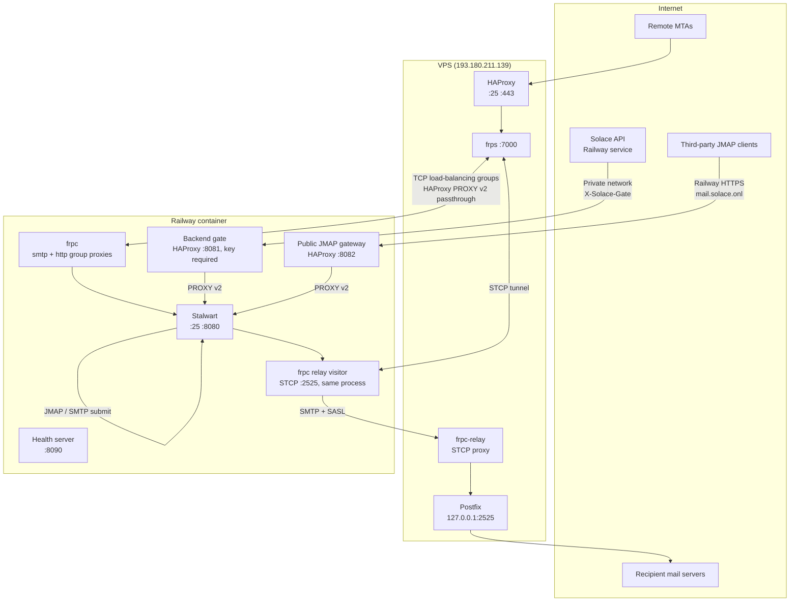
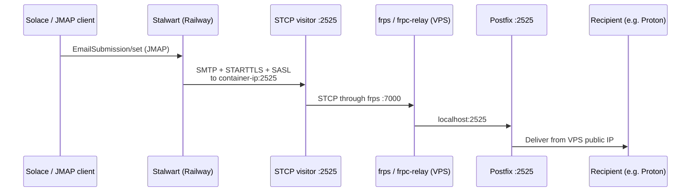
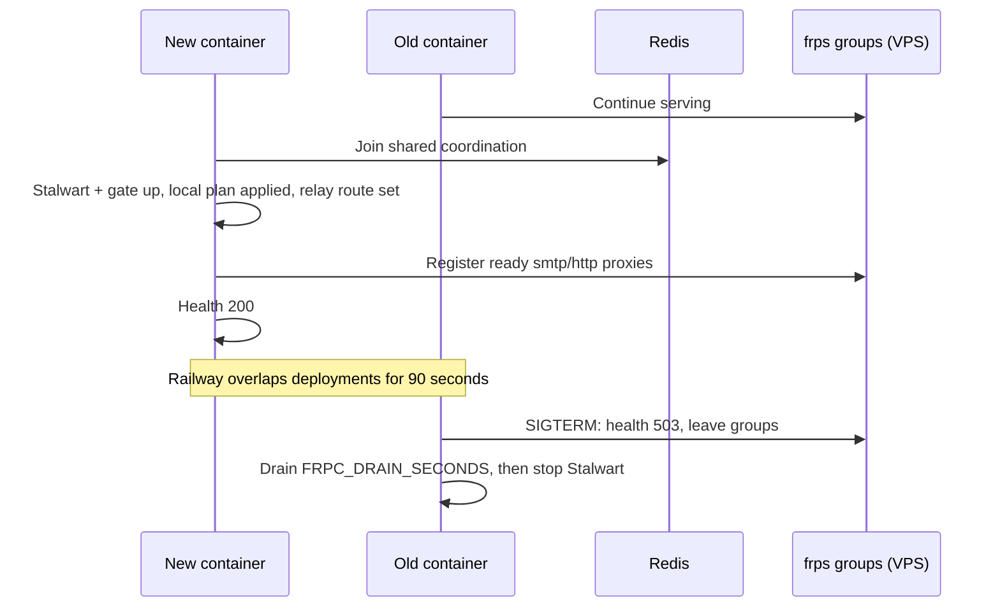

# Stalwart on Railway (Solace mail)

Stalwart runs on [Railway](https://railway.app). Public JMAP at
`https://mail.solace.onl` go directly through Railway HTTPS to the restricted public
gateway on `:8082`. The key-gated API entry on `:8081` stays separate; Solace's API
and notifications use it over Railway's encrypted private network. Both gateways
forward locally to Stalwart with PROXY v2 and never log request paths.

The VPS (`mx.solace.onl` / `193.180.211.139`) owns public SMTP and the outbound relay.
Railway containers connect outbound over frp for those routes. A tunnel outage can
delay SMTP delivery while public and private JMAP remain available, including on
startup: after a bounded tunnel wait, frpc reconnects in the background. Users sign
in through Solace, whose private OAuth bridge stays key-gated. Operators can open
`https://solace.onl/admin`, which redirects to Stalwart on its separate
`mail.solace.onl` origin. Its optional Solace session gate is described below.

The Stalwart plan declares `mx.solace.onl` as the default hostname and MX, with
`mail.solace.onl` explicitly advertised for JMAP. Its automatic DNS publisher must
keep that split. Before an HTTPS cutover, create the unproxied MX address, issue a
certificate covering it, align the VPS PTR and Postfix hostname, and verify SMTP.
Retain the original VPS HTTPS route and DNS snapshot for rollback until validation finishes.

Desired state for Stalwart objects lives in [`stalwart/plan/`](stalwart/plan/).
WebUI edits are overwritten on the next Railway boot. This tree lives in the Solace
monorepo at `apps/stalwart` (not a nested git repo).

The image and plans target **1.0.0**. Follow [the 1.0 migration runbook](UPGRADE-1.0.md)
before deploying them onto a populated 0.16 database; changing the image alone cannot upgrade it.

The admin-applied plan registers `solace-mail-bridge` as a first-party OAuth client.
Stalwart 1.0 mail-only third-party tokens exclude `x:AccountSettings/get` and `set`,
which both Solace apps need for encryption setup. First-party tokens retain the
account's existing permissions; they do not grant users administrator access.
Only a superuser can configure this client, so apply it before the API starts;
the scoped provisioner must not create or modify it. Keep its description and
callback aligned with the backend bridge. After changing its trust setting,
clear the API token cache by restarting the API and reload clients for fresh tokens.

## Backend provisioning principal

The Solace API must **not** hold an admin token. It reads mailbox, calendar and
contact data as the account owner (per-user OAuth bearers) and needs elevated
rights only to provision. `stalwart/plan/16-provisioner-role.ndjson` defines the
`solace-provisioner` role with exactly those permissions.

After applying the plan, create a dedicated account bound to that role and issue
it an API token, then set `STALWART_PROVISION_TOKEN` on the API. This step is
manual because the account secret must never live in the repo. Until it is done
the API falls back to the deprecated `STALWART_ADMIN_TOKEN`, which is what it
does today; retire that token once the scoped one works (plan 001 step 7).

## System overview



## Config as code

[`config.json`](railway-entrypoint.sh) only names the **DataStore** (templated from Railway `PG*` env).
Everything else is JMAP objects, applied from NDJSON on every boot:

```sh
scripts/stalwart-plan.sh dry-run
scripts/stalwart-plan.sh apply
scripts/stalwart-plan.sh snapshot
scripts/stalwart-plan.sh drift
scripts/stalwart-plan.sh dns-publish
```

`railway-entrypoint.sh` runs `stalwart-cli apply` after JMAP is up and **before** the relay IP patch.
Failing apply fails the boot.

**In git:** Domain `solace.onl`, DNS/ACME/DKIM _policy_, NetworkListeners, HTTP security, Cache/JMAP/SystemSettings, MTA-STS, SenderAuth, ReportSettings, BlobStore (S3 via `EnvironmentVariable`), MetricsStore/TracingStore, Alerts, WebHooks.

**Not in git:** user accounts, mailbox data, Certificates, DkimSignature private keys, `MtaRoute.host` (container IP), Tasks/queues/logs.

**Secrets** stay in Railway variables. Plan objects use `{"@type":"EnvironmentVariable","variableName":"..."}`. Snapshot strips secrets; omit a secret field on apply so live credentials are not wiped.

DKIM keys rotate through a scheduled `Task/DkimManagement` (`dkimManagement: Automatic`, every 90 days), and `dnsManagement: Automatic` publishes records through the `DnsServer` Cloudflare token. Check `stalwart-cli query Task` shows a pending `DkimManagement`; if none is pending (the 1.0 migration carried none over), create one for domain `b`. Stalwart adds and updates records but never deletes ones it stops advertising. `scripts/stalwart-plan.sh dns-publish` republishes on demand. `SystemSettings.services` advertises only JMAP, the one protocol the edge exposes. Do not flip MTA-STS to `enforce` until TLS-RPT reports arrive.

## Operator access

Set the web server's `STALWART_ADMIN_URL` to that environment's Stalwart
`https://<mail-host>/admin/` URL. `/admin` redirects only to this configured target;
an unset value returns 404. HTTPS is required except for local loopback HTTP.
Credentials, query strings and fragments are refused. Configure
`SOLACE_ADMIN_LOGIN_URL` on the mail service to the same environment's Solace
`https://<app-host>/login` URL. Local and preview instances have no implicit
production redirect. Use hosts that share the Solace session cookie domain; for
local HTTP, use `localhost` consistently and set `SOLACE_ADMIN_SESSION_COOKIE` to
`better-auth.session_token`. Configure `SOLACE_ADMIN_STEP_UP_COOKIE` too if the API
uses a custom cookie prefix.

The Railway gateway always requires a valid edge-supplied `X-Real-IP` in
`STALWART_ADMIN_ALLOW_IPS` for UI and direct Stalwart sign-in. Enabling Solace
sessions adds an authorization check and never replaces that network restriction.
Stalwart still requires its own administrator credentials. The existing account
passkey checks apply; this feature does not change password recovery or passkey
enrollment privileges.

Session mode is opt-in. IaC preserves `SOLACE_ADMIN_AUTH_URL` without assigning a
value, so applying the file does not enable it. Before enabling it:

1. Select the operator's opaque Solace user IDs and set `STALWART_ADMIN_USER_IDS`
   on the API. An empty list grants nobody access.
2. Set a random `STALWART_ADMIN_GATE_KEY` of at least 32 bytes on the mail service
   and reference the same secret from the API. The key is server-only and never
   belongs in the web environment or a `NEXT_PUBLIC_*` variable.
3. Deploy the API endpoint and gateway with session mode still disabled. Verify
   the operator networks and both environment-specific redirect targets.
4. Check the API's actual listening `PORT` and private hostname. If necessary,
   explicitly set `PORT` to the value its Railway domain already targets. Use
   `http://<API_PRIVATE_HOST>:<API_PORT>/api/internal/stalwart/admin-access` for
   the authorizer; there is no assumed port 8080. A Railway reference may use
   `${{"Solace API".RAILWAY_PRIVATE_DOMAIN}}` and `${{"Solace API".PORT}}` once
   `PORT` is explicitly configured.
5. Verify that the keyed authorizer returns 204 for the approved live session,
   refuses other accounts and missing credentials, then set
   `SOLACE_ADMIN_AUTH_URL` to that verified private URL. Validate the full browser
   login from an approved network.

The API verifies the gateway key in constant time and rate-limits each forwarded
client address to 240 checks per minute before looking up a session. Public
callers without the key receive 404 regardless of their account. The gateway
accepts only an exact 204, refuses duplicate authentication cookies and fails
closed for unavailable or malformed configuration. Missing or invalid operator
addresses are denied before any authorizer call. The client address reaches both
the authorizer's limiter and Stalwart's own login protections.

The HTTP client prefers IPv4 to match the API listener, disables retries and uses
a one-second server timeout with a 500 ms connection timeout. Lua has a one-second
execution budget and one state per HAProxy thread. Public requests without cookies
and responses without cookies skip cookie-processing actions. Authorization is
checked on every protected request so session revocation takes effect immediately;
there is no allow-cache that can outlive sign-out.

Only the session, persistence preference and passkey cookies go to the API. Renewal
cookies return to the browser; application cookies and gateway credentials never
reach Stalwart. No cookie, credential, upstream body or administrator address is
logged by these actions.

Public JMAP, discovery and monitoring remain independent of this authorizer and
retain Stalwart's own authentication and permissions. Existing administrator
bearers remain valid until Stalwart revokes or expires them; Solace sign-out does
not revoke those tokens. The VPS HTTPS rollback route keeps its separate operator
IP restriction. Pinned VPS SSH access and the Stalwart CLI remain the recovery path
while the Solace API is unavailable. This is operator tooling with no native screen.

## Inbound mail (Internet → Stalwart)

```mermaid
sequenceDiagram
    participant C as Remote MTA
    participant H as HAProxy (VPS)
    participant F as frps → frpc tunnel
    participant S as Stalwart (Railway)

    C->>H: SMTP :25
    Note over H: One PROXY v2 header from HAProxy; frpc must not add another
    H->>F: Forward to the localhost frps group port
    F->>S: frpc TCP proxy → Stalwart listener
    S-->>C: SMTP response
```

Every container runs one frpc that registers its proxies into frp **load-balancing
groups** on fixed frps ports, so HAProxy has a single backend per protocol and frps
spreads connections over whichever containers are registered. Proxy names carry a
per-container id (`smtp-<uuid>`, `http-<uuid>`) because frps requires unique names.
frpc logs go straight to the container's stderr.

| Group  | frps port | Container port |
|--------|-----------|----------------|
| `smtp` | 10025     | 25             |
| `http` | 18080     | 8080           |

The DATA stage on port 25 runs the system Sieve script [`stalwart/sieve/solace-simplelogin.sieve`](stalwart/sieve/solace-simplelogin.sieve). It strips any `X-Solace-*` markers. For DKIM-verified SimpleLogin forwards it puts the original sender in From, the reverse alias in Reply-To, and adds `X-Solace-SimpleLogin: forward` for the apps. The plan embeds the file in `30-mta.ndjson`, and `tests/test_simplelogin_sieve.py` keeps them in sync. To roll back, set the `MtaStageData` `then` to `"false"`. Deleting the line does not reset it, because `update` only patches.

## Outbound mail (Solace / JMAP → Internet)

Railway **blocks outbound SMTP ports** (25, 587, 465). Outbound mail uses an
frp **STCP** tunnel. At boot the entrypoint starts the visitor on `:2525`, patches `MtaRoute.host` to the container private IP, then reloads settings.

See [vps/OUTBOUND_RELAY.md](vps/OUTBOUND_RELAY.md).



## Rolling deployments

Mail containers have no attached volume. PostgreSQL stores mail metadata and the queue;
S3 stores blobs. The private `Redis-stalwart` service supplies shared ephemeral state
(`InMemoryStore/Redis`) and coordination (`Coordinator/Default`) while old and new
containers overlap. `STALWART_REDIS_URL` comes from a Railway variable reference and is
injected into a mode-0600 temporary plan; never commit its credentials. Stalwart's
standalone Redis configuration stores that URL in its protected settings database.



Joining the groups is the last boot step, so a registered container is ready to serve.
If frpc cannot register within `FRPC_READY_TIMEOUT_SECONDS`, boot fails. Configure Redis
and the coordinator before starting concurrent nodes: changing stores requires a restart,
not just `Action/ReloadSettings`. Long-lived JMAP push connections reconnect when their
container stops. Redis itself is a single ephemeral instance; rolling mail deployments
do not make Redis, PostgreSQL or the VPS highly available.

Railway probes `GET /healthz/ready` on `PORT` (8090). Healthcheck, overlap, and drain live in the repo-root [`.railway/railway.ts`](../../.railway/railway.ts).
Readiness needs a ready boot state, live Stalwart and frpc processes, and open
:25/:8080/:8081 ports. The relay listener is required at startup only: FRP closes it
while reconnecting, which must not mark the private API gate unhealthy.

### Tunnel mutual TLS (one-time rollout)

frps only accepts TLS from clients holding a cert signed by the Solace frp CA, and frpc
pins that CA (`serverName = "frps.solace"`), so a leaked `FRPC_TOKEN` or an
intercepted connection can no longer register proxies. Roll out in this order;
each step keeps the old side working:

1. `sh apps/stalwart/scripts/frp-tls-certs.sh <new dir>` and set the five `FRP_TLS_*`
   secrets on `mail-vps` as it prints. Store `ca.key` offline.
2. Set `FRPC_TLS_CERT` and `FRPC_TLS_KEY` on Railway `stalwart-mail` and let it redeploy:
   frpc presents the client cert, which today's frps ignores.
3. Run **Sync mail VPS** with `apply_frp`: frps now requires TLS plus a client cert, and
   `frpc-relay` uses one too. Tunnels drop for a few seconds while frps restarts.
4. Set `FRPC_TLS_CA` on Railway and let it redeploy: frpc now also verifies frps.

Certs last five years (`FRP_TLS_DAYS`); rotating mints a new CA, so repeat all four steps.

## Repository layout

| Path | Purpose |
|------|---------|
| `stalwart/plan/` | Desired-state NDJSON (`stalwart-cli apply` on boot) |
| `scripts/stalwart-plan.sh` | apply / dry-run / snapshot / drift / dns-publish |
| `scripts/sync-haproxy-cert.py` | Export Stalwart ACME cert → HAProxy PEM |
| `scripts/test-relay-route.sh` | Offline tests for relay-route helpers |
| `scripts/frp-tls-certs.sh` | Mints the frp CA, frps server cert and frpc client cert for tunnel mutual TLS |
| `railway-entrypoint.sh` | Stalwart + health server + plan apply + relay IP, then frpc joins the tunnel groups; SIGTERM leaves them before stopping Stalwart |
| `backend-gate.cfg` | HAProxy gate for the Solace API: key check, path allowlist, `X-Real-IP` → PROXY v2 to Stalwart `:8080` |
| `Dockerfile` | Mail image (Railway `rootDirectory: apps/stalwart`) |
| [`vps/README.md`](vps/README.md) | VPS services, cutover, cert sync |
| `../../.github/workflows/sync-haproxy-cert.yml` | Weekly / on-demand HAProxy cert sync |
| `../../.railway/railway.ts` | Solace Railway IaC |

## Railway environment variables

| Variable | Required | Purpose |
|----------|----------|---------|
| `FRPS_ADDR` | yes | VPS IP or hostname |
| `FRPC_TOKEN` | yes | frp auth token (must match `FRP_TOKEN` in GitHub Environment `mail-vps`) |
| `FRPC_RELAY_STCP_KEY` | yes | Relay STCP secret (must match `FRP_RELAY_STCP_KEY` in `mail-vps`); missing key fails boot |
| `FRPC_VERSION` | build | Pins the frpc version used by the Docker build; production currently uses `0.71.1` |
| `STALWART_ADMIN_TOKEN` | yes | Plan apply + relay route at startup |
| `STALWART_ADMIN_ALLOW_IPS` | yes | Operator networks required in both legacy and session modes; missing or invalid addresses fail closed |
| `SOLACE_ADMIN_AUTH_URL` | opt-in | Verified private API URL including its actual port; kept unset until the key, operator IDs and targets are configured |
| `SOLACE_ADMIN_LOGIN_URL` | session mode | Environment-specific Solace `/login` URL; HTTPS except loopback HTTP |
| `STALWART_ADMIN_GATE_KEY` | session mode | Shared server-only random key of at least 32 bytes; the API references the mail service value |
| `STALWART_ADMIN_URL` | web only | Environment-specific Stalwart `/admin/` target; unset disables the web entry |
| `STALWART_ADMIN_USER_IDS` | API only | Explicit opaque Solace user IDs allowed through the UI gate; empty grants nobody access |
| `STALWART_GATE_KEY`             | yes      | Backend gate key (32+ chars); only its SHA-256 reaches HAProxy; missing key fails boot. API and notifications reference the same key and send `X-Solace-Gate` only to their configured HTTPS or Railway-private origin |
| `STALWART_REDIS_URL` | yes | Private Redis connection for shared transient state and coordination during overlapping mail deployments |
| `STALWART_WEBHOOK_SECRET` | yes | HMAC key the plan's mail-ingest webhook signs with; missing key fails boot |
| `PORT` | yes | Set to `8090` — Railway healthcheck port |
| `PGHOST`, `PGPASSWORD`, etc. | yes | PostgreSQL (Railway plugin) |
| `BUCKET` / `BUCKET_*` | yes | Railway bucket refs for S3 BlobStore |
| `FRPC_READY_TIMEOUT_SECONDS` | no | Deadline for frpc's proxies to register and the relay visitor to listen (default `120` seconds); timeout fails boot |
| `FRPC_DRAIN_SECONDS` | no | Wait between leaving the tunnel groups and stopping Stalwart on SIGTERM (default `10`) |
| `FRPC_TLS_CERT`, `FRPC_TLS_KEY` | rollout | Base64 PEM client cert/key from `scripts/frp-tls-certs.sh`; required once frps enforces mutual TLS |
| `FRPC_TLS_CA` | rollout | Base64 PEM of the frp CA; set after frps has the new server cert, then frpc verifies frps |
| `STALWART_HTTP_PORT` | no | Stalwart HTTP/JMAP port (default `8080`) |
| `STALWART_GATE_PORT` | no | Backend gate port, the Railway domain's target (default `8081`) |
| `RELAY_ROUTE_ID` | no | Stalwart MtaRoute id (default `ivnbzc1aaba9`) |
| `RELAY_BIND_ADDR` | no | Override container private IP for relay route |
| `PG_POOL_MAX_CONNECTIONS` | no | Stalwart → Postgres pool size (default `32`, matching JMAP's 32 concurrent requests) |

Use the **private** Postgres hostname (`*.railway.internal`). Message bodies live in the Railway bucket (`BlobStore` S3); Postgres holds metadata.

Leave `STALWART_RECOVERY_MODE` unset for normal operation; set it only for a planned recovery. The CLI helper uses `STALWART_ADMIN_TOKEN` unless a local `STALWART_TOKEN` override is supplied. The plan signs the ingest webhook with this service's `STALWART_WEBHOOK_SECRET`; the API references the same variable to verify it.

The mail PostgreSQL instance allows 100 connections, enough for two overlapping Stalwart pools of 32 plus administration. Its 128 MiB shared buffer cache is unchanged. The setting lives in PostgreSQL's persistent `postgresql.auto.conf`; recovery details are in [UPGRADE-1.0.md](UPGRADE-1.0.md).

The Dockerfile enables background release of unused allocator pages through jemalloc's `/etc/malloc.conf` symlink. The official binary's network-binding capability disables environment-based allocator configuration under the service user, so neither `MALLOC_CONF` nor `_RJEM_MALLOC_CONF` works for this deployment. Arena counts and decay times retain upstream defaults.

The backend gate caps HAProxy at eight worker threads, matching the Railway CPU quota. Automatic detection otherwise follows the host's larger CPU set and wastes memory on extra workers. Review this cap if the service's CPU quota changes.

## HA verification

```sh
python3 -B -m unittest discover -s apps/stalwart/tests -v
sh apps/stalwart/scripts/test-relay-route.sh
shellcheck apps/stalwart/railway-entrypoint.sh apps/stalwart/vps/apply-vps-repo.sh
```

Run these from the monorepo root. The default suite covers the rendered frpc config,
shutdown order (leave the groups, then stop Stalwart), health, and boot-time secret
checks. For the optional loopback-only frp
integration test, set `FRPC_TEST_BINARY` and `FRPS_TEST_BINARY` to existing
version-matched binaries; it overlaps two containers in one group and checks that the
old one leaves without a failed connection. It uses temporary ports/configs and dummy
credentials; it does not access mail.
For the backend gate test, set `HAPROXY_TEST_BINARY`; it runs `backend-gate.cfg`
in front of a loopback PROXY v2 stub.
Set `STALWART_TEST_IMAGE` to a built mail image to verify background page release
under the container's service user, preserving the official binary's capabilities.

## Status page

Uptime monitoring: [`apps/gatus/`](../gatus/README.md). Discord downtime alerts are Gatus-only (`DISCORD_WEBHOOK_URL`). Stalwart Enterprise Alerts in `stalwart/plan/40-integrations.ndjson` email `admin@solace.onl` for live counters.

## VPS

Copy configs from `vps/` to the VPS, enable services, and open firewall ports
22, 25, 80, 443, 7000. Full reference: [vps/README.md](vps/README.md).
