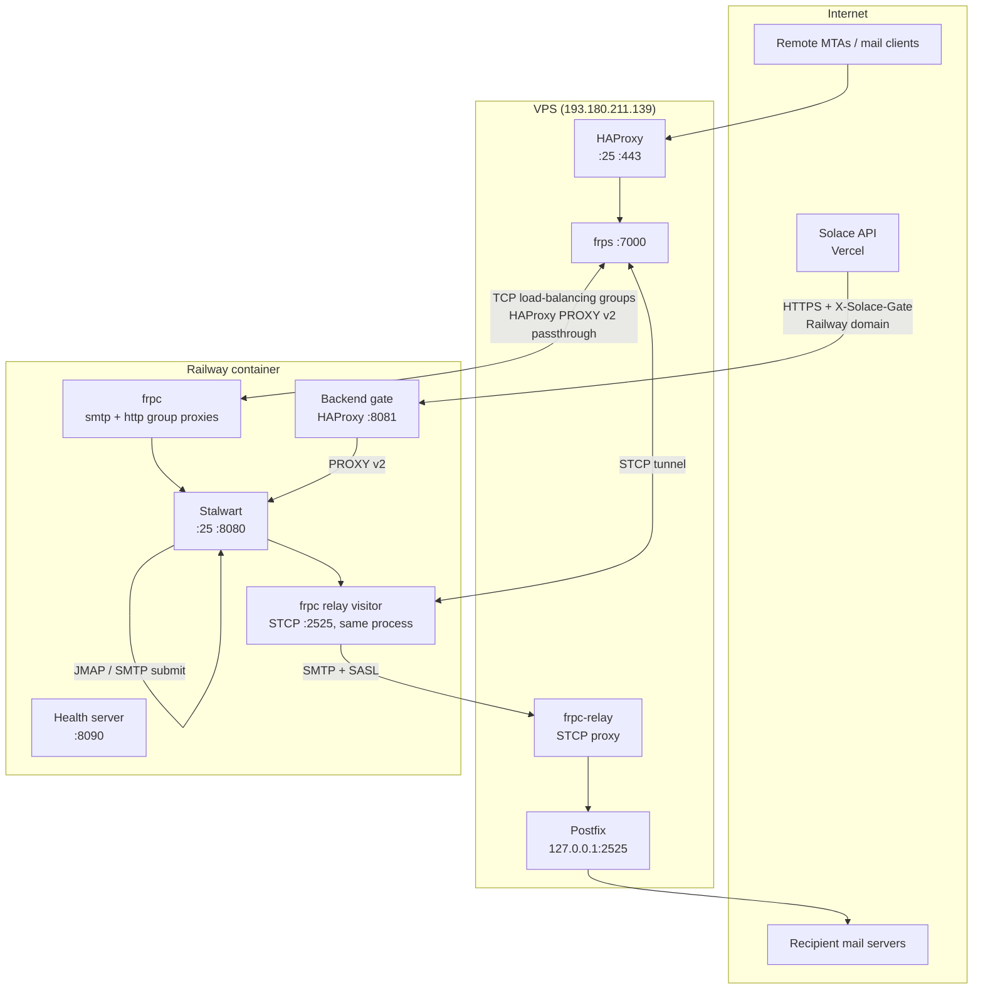
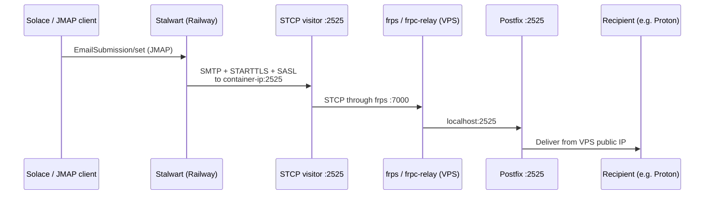
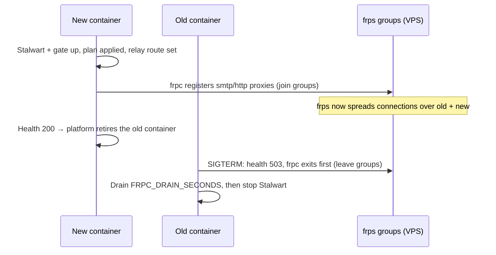

# Stalwart on Railway (Solace mail)

Stalwart mail server runs on [Railway](https://railway.app). A public VPS
(`mail.solace.onl` / `193.180.211.139`) owns the MX, TLS certificates, and
inbound ports. Railway containers connect **outbound** to the VPS over frp. The
only inbound Railway path is the key-gated backend gate
(`stalwart-mail-production.up.railway.app` → HAProxy `:8081`,
[`backend-gate.cfg`](backend-gate.cfg)), used by the Solace API so app mail does
not depend on the VPS's upstream. Third-party clients and the notifications worker
keep using `mail.solace.onl`.

Desired state for Stalwart objects lives in [`stalwart/plan/`](stalwart/plan/).
WebUI edits are overwritten on the next Railway boot. This tree lives in the Solace
monorepo at `apps/stalwart` (not a nested git repo).

## Backend provisioning principal

The Solace API must **not** hold an admin token. It reads mailbox, calendar and
contact data as the account owner (per-user OAuth bearers) and needs elevated
rights only to provision. `stalwart/plan/16-provisioner-role.ndjson` defines the
`solace-provisioner` role with exactly those permissions.

After applying the plan, create a dedicated account bound to that role and issue
it an API token, then set `STALWART_PROVISION_TOKEN` on the API. This step is
manual because the account secret must never live in the repo. Until it is done
the API falls back to the deprecated `STALWART_ADMIN_TOKEN`; retire that token
once the scoped one works.

## System overview



## Config as code

[`config.json`](railway-entrypoint.sh) only names the **DataStore** (templated from Railway `PG*` env).
Everything else is JMAP objects, applied from NDJSON on every boot:

```sh
scripts/stalwart-plan.sh dry-run
scripts/stalwart-plan.sh apply
scripts/stalwart-plan.sh snapshot
scripts/stalwart-plan.sh drift
scripts/stalwart-plan.sh dns-publish
```

`railway-entrypoint.sh` runs `stalwart-cli apply` after JMAP is up and **before** the relay IP patch.
Failing apply fails the boot.

**In git:** Domain `solace.onl`, DNS/ACME/DKIM *policy*, NetworkListeners, HTTP security, Cache/JMAP/SystemSettings, MTA-STS, SenderAuth, ReportSettings, BlobStore (S3 via `EnvironmentVariable`), MetricsStore/TracingStore, Alerts, WebHooks.

**Not in git:** user accounts, mailbox data, Certificates, DkimSignature private keys, `MtaRoute.address` (container IP), Tasks/queues/logs.

**Secrets** stay in Railway variables. Plan objects use `{"@type":"EnvironmentVariable","variableName":"..."}`. Snapshot strips secrets; omit a secret field on apply so live credentials are not wiped.

DKIM keys rotate automatically (`dkimManagement: Automatic`). Stalwart does **not** continuously reconcile Cloudflare; after a new selector, run `scripts/stalwart-plan.sh dns-publish`. Do not flip MTA-STS to `enforce` until TLS-RPT reports arrive.

Admin UI is allowlisted on public HTTPS via VPS file `/etc/haproxy/admin-allow.lst` (from GitHub Environment secret `ADMIN_ALLOW_IP` on `mail-vps`; never committed). Tunnel fallback: `ssh -N -L 8080:127.0.0.1:8080 USER@mail.solace.onl` then `http://127.0.0.1:8080/admin/`.

## Inbound mail (Internet → Stalwart)

```mermaid
sequenceDiagram
    participant C as Mail client / MTA
    participant H as HAProxy (VPS)
    participant F as frps → frpc tunnel
    participant S as Stalwart (Railway)

    C->>H: SMTP :25 / HTTPS :443
    Note over H: TLS termination on :443<br/>one PROXY v2 header from HAProxy; frpc must not add another
    H->>F: Forward to the localhost frps group port
    F->>S: frpc TCP proxy → Stalwart listener
    S-->>C: Mail delivery / JMAP
```

Every container runs one frpc that registers its proxies into frp **load-balancing
groups** on fixed frps ports, so HAProxy has a single backend per protocol and frps
spreads connections over whichever containers are registered. Proxy names carry a
per-container id (`smtp-<uuid>`, `http-<uuid>`) because frps requires unique names.
frpc logs go straight to the container's stderr.

| Group  | frps port | Container port |
|--------|-----------|----------------|
| `smtp` | 10025     | 25             |
| `http` | 18080     | 8080           |

The DATA stage on port 25 runs the system Sieve script [`stalwart/sieve/solace-simplelogin.sieve`](stalwart/sieve/solace-simplelogin.sieve). It strips any `X-Solace-*` markers. For DKIM-verified SimpleLogin forwards it puts the original sender in From, the reverse alias in Reply-To, and adds `X-Solace-SimpleLogin: forward` for the apps. The plan embeds the file in `30-mta.ndjson`, and `tests/test_simplelogin_sieve.py` keeps them in sync. To roll back, set the `MtaStageData` `then` to `"false"`. Deleting the line does not reset it, because `update` only patches.

## Outbound mail (Solace / JMAP → Internet)

Railway **blocks outbound SMTP ports** (25, 587, 465). Outbound mail uses an
frp **STCP** tunnel. At boot the entrypoint starts the visitor on `:2525`, patches `MtaRoute.address` to the container private IP, then reloads settings.

See [vps/OUTBOUND_RELAY.md](vps/OUTBOUND_RELAY.md).



## Zero-downtime deploys



Joining the groups is the last boot step, so a registered container is a ready one; there
is no slot coordination with the VPS and no deploy order between VPS and image. If frpc
cannot register within `FRPC_READY_TIMEOUT_SECONDS` (for example a blue/green proxy still
holds the port), boot fails and the platform keeps the old container. For a few seconds
both containers serve. They share Postgres and the blob store but no cache coordinator,
so a client may briefly see state cached on the other container; long-lived IMAP IDLE /
JMAP push connections on the old container drop and clients reconnect.

Railway probes `GET /healthz/ready` on `PORT` (8090). Healthcheck, overlap, and drain live in the repo-root [`.railway/railway.ts`](../../.railway/railway.ts).
Readiness needs a ready boot state, live Stalwart and frpc processes, and open
:25/:8080/:8081/relay ports. It deliberately does not probe the VPS, so a tunnel blip
never marks the container (and with it the VPS-independent API gate) unhealthy.

### One-time cutover from blue/green slots

The group ports reuse the blue slot's ports, which the old image's tunnels may hold.

1. On Railway `stalwart-mail` set `FRPC_STANDBY_ENABLED=false` and
   `RAILWAY_DEPLOYMENT_OVERLAP_SECONDS=600`, let it redeploy, and repeat until
   `/slot-manager/status` reports `active: green` with blue unoccupied.
2. Deploy this image. It joins the groups on the blue ports (10025/18080).
3. Within the overlap window run `sudo stalwart-switch-slot blue` on the VPS; it probes
   the new container on 18080 and moves HAProxy's weight to it.
4. After the old container is gone, ship the VPS cleanup (single HAProxy server per
   backend, slot-manager/watcher retired) and drop `FRPC_SLOT`, `FRPC_STANDBY_ENABLED`,
   `SLOT_MANAGER_TOKEN` and the overlap override from Railway.

## Repository layout

| Path | Purpose |
|------|---------|
| `stalwart/plan/` | Desired-state NDJSON (`stalwart-cli apply` on boot) |
| `scripts/stalwart-plan.sh` | apply / dry-run / snapshot / drift / dns-publish |
| `scripts/sync-haproxy-cert.py` | Export Stalwart ACME cert → HAProxy PEM |
| `scripts/test-relay-route.sh` | Offline tests for relay-route helpers |
| `railway-entrypoint.sh` | Stalwart + health server + plan apply + relay IP, then frpc joins the tunnel groups; SIGTERM leaves them before stopping Stalwart |
| `backend-gate.cfg` | HAProxy gate for the Solace API: key check, path allowlist, `X-Real-IP` → PROXY v2 to Stalwart `:8080` |
| `Dockerfile` | Mail image (Railway `rootDirectory: apps/stalwart`) |
| [`vps/README.md`](vps/README.md) | VPS services, cutover, cert sync |
| `../../.github/workflows/sync-haproxy-cert.yml` | Weekly / on-demand HAProxy cert sync |
| `../../.railway/railway.ts` | Solace Railway IaC |

## Railway environment variables

| Variable | Required | Purpose |
|----------|----------|---------|
| `FRPS_ADDR` | yes | VPS IP or hostname |
| `FRPC_TOKEN` | yes | frp auth token (must match `FRP_TOKEN` in GitHub Environment `mail-vps`) |
| `FRPC_RELAY_STCP_KEY` | yes | Relay STCP secret (must match `FRP_RELAY_STCP_KEY` in `mail-vps`); missing key fails boot |
| `STALWART_ADMIN_TOKEN` | yes | Plan apply + relay route at startup |
| `STALWART_GATE_KEY` | yes | Backend gate key (32+ chars, same value as Vercel `STALWART_GATE_KEY`); only its SHA-256 reaches HAProxy; missing key fails boot |
| `PORT` | yes | Set to `8090` — Railway healthcheck port |
| `PGHOST`, `PGPASSWORD`, etc. | yes | PostgreSQL (Railway plugin) |
| `BUCKET` / `BUCKET_*` | yes | Railway bucket refs for S3 BlobStore |
| `STALWART_MAIL_INGEST_WEBHOOK_SECRET` | no | HMAC for Solace `message-ingest.ham` webhook (omit from plan if unset; live HMAC is kept) |
| `FRPC_READY_TIMEOUT_SECONDS` | no | Deadline for frpc's proxies to register and the relay visitor to listen (default `120` seconds); timeout fails boot |
| `FRPC_DRAIN_SECONDS` | no | Wait between leaving the tunnel groups and stopping Stalwart on SIGTERM (default `10`) |
| `STALWART_HTTP_PORT` | no | Stalwart HTTP/JMAP port (default `8080`) |
| `STALWART_GATE_PORT` | no | Backend gate port, the Railway domain's target (default `8081`) |
| `RELAY_ROUTE_ID` | no | Stalwart MtaRoute id (default `ivnbzc1aaba9`) |
| `RELAY_BIND_ADDR` | no | Override container private IP for relay route |
| `PG_POOL_MAX_CONNECTIONS` | no | Stalwart → Postgres pool size (default `32`, matching JMAP's 32 concurrent requests) |

Use the **private** Postgres hostname (`*.railway.internal`). Message bodies live in the Railway bucket (`BlobStore` S3); Postgres holds metadata.

## HA verification

```sh
python3 -B -m unittest discover -s apps/stalwart/tests -v
sh apps/stalwart/scripts/test-relay-route.sh
shellcheck apps/stalwart/railway-entrypoint.sh apps/stalwart/vps/stalwart-switch-slot.sh
```

Run these from the monorepo root. The default suite covers the rendered frpc config,
shutdown order (leave the groups, then stop Stalwart), health, boot-time secret checks,
and the VPS slot-manager until it is retired. For the optional loopback-only frp
integration test, set `FRPC_TEST_BINARY` and `FRPS_TEST_BINARY` to existing
version-matched binaries; it overlaps two containers in one group and checks that the
old one leaves without a failed connection. It uses temporary ports/configs and dummy
credentials; it does not access mail.
For the backend gate test, set `HAPROXY_TEST_BINARY`; it runs `backend-gate.cfg`
in front of a loopback PROXY v2 stub.

## Status page

Uptime monitoring: [`apps/gatus/`](../gatus/README.md). Discord downtime alerts are Gatus-only (`DISCORD_WEBHOOK_URL`). Stalwart Enterprise Alerts in `stalwart/plan/40-integrations.ndjson` email `admin@solace.onl` for live counters.

## VPS

Copy configs from `vps/` to the VPS, enable services, and open firewall ports
22, 25, 80, 443, 7000. Full reference: [vps/README.md](vps/README.md).
