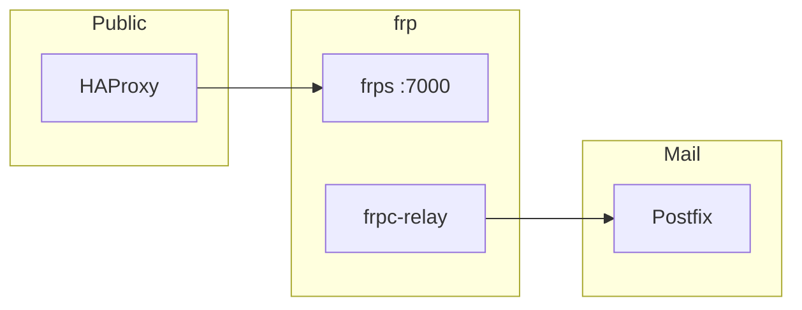

# VPS services

Public VPS at `193.180.211.139` (`mail.solace.onl`) for Stalwart on Railway.
Architecture diagrams: [README.md](../README.md).

## Service map



## Services

All systemd units should be enabled (`systemctl enable`) for boot.

### HAProxy

- **Role:** Public TCP edge with PROXY v2 to the frps mail groups; it terminates no TLS.
- **Ports:** 25 (SMTP, Stalwart STARTTLS), 80 (HTTPS redirect), 443 (TLS passthrough).
  - **:443** serves `mta-sts`, `autoconfig` and `autodiscover.solace.onl` (DNS points here). HAProxy passes the TLS stream untouched to Stalwart's `https` listener (`:8443`, group port `18443`), which presents its own ACME certificate; Stalwart is the only certificate manager, so nothing is copied to the VPS.
  - Stalwart's `Http.allowedEndpoints` rule (`stalwart/plan/10-network.ndjson`) admits only the public paths on that listener (`/jmap`, `/.well-known/`, `/api/discover`, autoconfig, autodiscover) and returns 404 for everything else, including `..`, `//` and encoded slashes or dots. There is no admin route through the VPS; Stalwart's UI is reached through Railway behind the Solace session gate.
  - Loopback Admin UI remains on `127.0.0.1:8080` via SSH tunnel.
- **Repo:** `vps/haproxy.cfg` → `/etc/haproxy/haproxy.cfg`
- **Backends:** one server each, the frps group ports `127.0.0.1:10025` (smtp), `127.0.0.1:18443` (https) and `127.0.0.1:18080` (the SSH-tunnel admin UI)

### Automated VPS deploy (protected)

Merging allowlisted `apps/stalwart/vps/` files to **`master`** triggers [`.github/workflows/sync-mail-vps.yml`](../../../.github/workflows/sync-mail-vps.yml), which SSHs to the VPS and runs [`apply-vps-repo.sh`](apply-vps-repo.sh).

Security model: **merge-time gates + narrow deploy**, not a manual Actions click.

| Gate | Purpose |
|------|---------|
| Branch protection on `master` | No drive-by pushes; PR + Code Owner review required |
| CODEOWNERS (`@IIRoan`) | `.github/workflows/` + `apps/stalwart/vps/` need owner review |
| Environment `mail-vps` | Secrets only; deployment branches limited to `master` |
| No `pull_request` trigger | Fork PRs never receive `mail-vps` secrets |
| Explicit file allowlist | Only known basenames are copied (not a recursive `vps/` dump) |
| `apply-vps-repo.sh` default-deny | Skips frp config installs unless opted in |
| `apply-vps-repo.sh` hook guard | Refuses to run while haproxy's systemd unit still calls a retired slot script |
| Manual `workflow_dispatch` | Owner-only fallback (e.g. re-run without a new commit) |

#### Required GitHub settings

These must be on for the model to hold (script below applies them when you have admin rights):

1. **Branch protection** on `master`:
   - Require a pull request before merging
   - Require review from Code Owners
   - Restrict who can push / dismiss reviews (you / admins)
   - Block force pushes and deletions
2. **Environment `mail-vps`**:
   - Deployment branches: **Selected** → `master`
   - Optional: required reviewers if you want a second click after merge (solo owners usually skip this so deploy stays automatic after a protected merge)
3. Never attach `mail-vps` secrets to workflows that run on `pull_request` from forks.

For a read-only incident check, dispatch **Sync mail VPS** with `diagnose_only=true`
and UTC ISO `since`/`until` values at most 20 minutes apart. This skips staging,
deployment and reloads. It emits service states, uptime, cumulative TCP counters and
journal event-category counts; journal messages, client addresses and credentials
never enter the report.

Read the JSON under **Actions → Sync mail VPS → Apply VPS repo → Read-only VPS diagnostics**.
This repository is public, so those logs expose operational counters and service
states publicly. The command uses the existing administrator deploy credential;
its read-only behavior is enforced by the checked-in script, not a restricted SSH
role. Only trusted default-branch code may use it. Repository write access remains
production access, so protect the default branch as described above.

Local / emergency apply (bypasses GitHub; trusted shell only):

```bash
sudo ./apply-vps-repo.sh .
```

Secrets: Environment **`mail-vps`** (see [GitHub Environment `mail-vps`](#github-environment-mail-vps)). SSH user defaults to `Roan`. Long-term: least-privilege deploy user with sudo limited to `apply-vps-repo.sh` + `haproxy` reload.

### frps

- **Role:** Accepts inbound frp tunnels from Railway.
- **Port:** 7000 (control); dynamic proxy ports whitelisted in `vps/frps.toml`
- **TLS:** forced, with client certs checked against the Solace frp CA in `/etc/frp/tls/` (installed by `apply_frp` from the `FRP_TLS_*` secrets; rollout order in [README.md](../README.md#tunnel-mutual-tls-one-time-rollout))
- **Repo:** `vps/frps.toml` → `/etc/frp/frps.toml` (mode 600; `__FRP_TOKEN__` rendered from `mail-vps` secret `FRP_TOKEN` by **Sync mail VPS** with `apply_frp`)

### frpc-relay

- **Role:** STCP proxy exposing Postfix `127.0.0.1:2525` to Railway relay visitors.
- **Repo:** `vps/frpc-relay.toml` → `/etc/frp/frpc-relay.toml` (mode 600; token and `__FRP_RELAY_STCP_KEY__` rendered from `mail-vps` secrets)
- **Required** for outbound mail from Railway (see [OUTBOUND_RELAY.md](OUTBOUND_RELAY.md))

### Postfix

- **Role:** Authenticated submission relay; delivers to the internet from the VPS IP.
- **Listen:** `127.0.0.1:2525` (STCP from Railway), `127.0.0.1:587` (manual tests on the VPS); nothing listens publicly
- **SASL user:** `relay-client@mail.solace.onl`
- **Repo:** `vps/postfix-main.cf`, `vps/postfix-master.cf`

### gatus-monitor (optional)

- **Role:** JSON health snapshot for Gatus SSH probes from Railway (`status.solace.onl`).
- **Repo:** `vps/gatus-monitor.sh` → `/usr/local/bin/gatus-monitor.sh`
- **Setup:** See [apps/gatus/README.md](../../gatus/README.md)
- **Reports:** service states, online members per frp group (`smtp`, `http`; two during a deploy), JMAP through the group port, and the Postfix queue

## Tunnel groups

frps exposes three group ports on loopback: `10025` (smtp), `18443` (https) and `18080` (http). Each
Stalwart container's frpc registers one proxy per group under a per-container name, and
frps spreads connections across every registered container. HAProxy has a single server
per backend pointing at those ports, so a deploy needs no VPS action: the new container
joins the groups, the old one leaves them on SIGTERM, and the port never goes empty. The
container side is described in [README.md](../README.md#zero-downtime-deploys).

## Operations

Admin UI: from an allowlisted egress IP open `https://mail.solace.onl/admin/`. Otherwise tunnel:

```bash
ssh -N -L 8080:127.0.0.1:8080 USER@mail.solace.onl
# browse http://127.0.0.1:8080/admin/
```

```bash
# Service status
systemctl status haproxy frps frpc-relay postfix

# Containers registered in the tunnel groups (two during a deploy)
curl -s http://127.0.0.1:7500/api/proxy/tcp | python3 -m json.tool | grep -E '"(name|status)"'

# Health snapshot (same JSON Gatus reads)
/usr/local/bin/gatus-monitor.sh

# Config validation
sudo haproxy -c -f /etc/haproxy/haproxy.cfg && sudo systemctl reload haproxy
sudo postfix check && sudo systemctl reload postfix
```

## Firewall (UFW)

Allow: 22, 25, 80, 443, 7000 (frp control from Railway).

Port 80 must be open so HAProxy can 301 to HTTPS and send HSTS. Do not leave it firewalled/black-holed.

Ports 587 and 2525 are **not** exposed publicly — Postfix binds them to loopback and Railway reaches 2525 only via the STCP tunnel.

## GitHub Environment `mail-vps`

**Sync mail VPS** (`master` only) holds:

| Secret | Purpose |
|--------|---------|
| `VPS_SSH_PRIVATE_KEY` | Deploy key for the VPS admin user (`VPS_SSH_USER`), which runs `apply-vps-repo.sh` with sudo |
| `VPS_SSH_HOST` | default `mx.solace.onl` |
| `VPS_SSH_USER` | default `Roan` |
| `VPS_SSH_KNOWN_HOSTS` | Pinned VPS host key: `ssh-keyscan -t ed25519 <VPS_SSH_HOST>`, after checking its `ssh-keygen -lf -` fingerprint against `ssh-keygen -lf /etc/ssh/ssh_host_ed25519_key.pub` on the VPS |
| `FRP_TOKEN` | frps auth token (32+ alphanumeric); same value as Railway `FRPC_TOKEN`; never in git |
| `FRP_RELAY_STCP_KEY` | Relay STCP secret (32+ alphanumeric); same value as Railway `FRPC_RELAY_STCP_KEY`; never in git |
| `FRP_TLS_CA`, `FRP_TLS_SERVER_CERT`, `FRP_TLS_SERVER_KEY`, `FRP_TLS_CLIENT_CERT`, `FRP_TLS_CLIENT_KEY` | Base64 PEMs from `scripts/frp-tls-certs.sh` for frps and `frpc-relay`; `apply_frp` refuses to run without a matching set |

Public JMAP uses Railway HTTPS at `mail.solace.onl`. Connect SSH and SMTP to `mx.solace.onl`.

HAProxy / VPS deploy is automated on protected `master` merges ([`.github/workflows/sync-mail-vps.yml`](../../../.github/workflows/sync-mail-vps.yml)); see [Automated VPS deploy](#automated-vps-deploy-protected).
