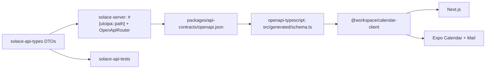

# Plan 001: Rewrite the Solace backend in Rust

> Executor: rewrite the backend in Rust, authentication included; deploy it to a Railway test environment and test it there; switch production in one change; then delete the TypeScript backend. There is no auth bridge, no side-by-side comparison deployment, and no partial production rollout. Read this plan fully before starting and do the steps in order. This plan is not permission to deploy to production.

## Goal and constraints

- **Goal:** the same API, behavior, and data on a Rust backend with much lower process RAM. Hosting cost is not a decision input.
- **Unchanged:** the Postgres schema and its 53 migrations (Prisma keeps applying them until step 7), the wire contract that shipped native apps rely on, the privacy and E2EE rules in AGENTS §2, JMAP-only mail (§8), the Go notifications worker, and Stalwart.
- **Known privacy gaps** (AGENTS §2) are ported unchanged, never wider, and fixed in step 7. A rewrite that also changes behavior can't be checked against the old backend, and a fix needing a client release would block the cutover.
- **During the rewrite** every backend change ships with a test-suite case (step 3), so the Rust port inherits it as a failing test.
- Planned at `9867af06c9d873e5522fdd298b9cf585121e7c24` on 2026-10-14. Drift check before starting: `git diff --stat 9867af06..HEAD -- apps/backend packages/calendar-core packages/calendar-client packages/calendar-ics apps/web packages/native-core apps/native-calendar apps/native-mail`.

## Behavior the rewrite must match exactly

The bugs listed under step 5's "Fixed before cutover" are the exception: Rust fixes them on purpose, and the suite asserts per backend there.

**Sessions and auth** (`apps/backend/lib/auth.ts`)

- Cookie names `__Secure-better-auth.session_token` (production) and `better-auth.session_token` (development), the HMAC-signed value format, and `crossSubDomainCookies` on the RP ID domain stay permanently. Changing them signs out every native install.
- Sessions last 14 days, renew daily, and clients refresh hourly (`packages/calendar-core/src/auth-session.ts`). Every Set-Cookie header is forwarded, never just the first.
- Rust does not implement the 5-minute `session_data` cookie cache. It reads the session row on every request, which is also stricter on revocation, and expires any `session_data` cookie it receives. The native cookie jar must drop it (`packages/native-core/src/lib/session-cookie.ts:48`).
- Passwords are scrypt `N=16384, r=16, p=1, dkLen=64`, NFKC-normalized, stored as `hexSalt:hexKey`. The hex salt **string** is the scrypt salt. Each hash allocates 32 MiB.
- Also preserve:
  - stored passkeys and the step-up flow (`passkey-step-up.ts`, `passkey-bridge-session.ts`);
  - one-time tokens (3 minutes, stored hashed);
  - Expo origin and cookie handling;
  - invite-gated sign-up with `markInviteAccepted` mailbox approval;
  - legacy cookie cleanup (`auth-cookie-migration.ts`);
  - IP and user-agent stripping on session create;
  - Postgres-backed rate limits with HMACed keys;
  - password reset and updated mail over JMAP noreply.
- The `jwt()` plugin has no caller in web, native, the worker, or Stalwart. Confirm zero hits on `/api/auth/token` and `/api/auth/jwks` in production logs and don't port it. If there are hits, port it, including decrypting the existing JWKS keys.

**Data** (`apps/backend/prisma/`)

- 30 `@default(cuid())` IDs and 25 `@updatedAt` columns are set by the Prisma client, not by Postgres. Rust must set them on every insert and update. Better Auth tables use their own 32-character IDs.
- All 96 timestamp columns are `TIMESTAMP(3)` without time zone, holding UTC. The wire format is JS `toISOString()`: exactly three fractional digits and `Z`.
- Ownership and share checks, transactions, ordering, pagination, retention, account deletion, and outbox writes behave as today.

**Wire contract** (`apps/backend/contracts/`, `packages/calendar-core/src/route-schemas.ts`)

- JSON fields are camelCase. Requests reject unknown fields. PATCH fields distinguish omitted, `null`, and a value.
- Query strings coerce like Zod does. String limits count UTF-16 code units. Errors use the `lib/errors.ts` envelope.
- Event listing reproduces `EventService.list`: recurring and modified instances, categories, calendars, participant filtering, and sort order.
- `packages/calendar-ics/src/recurrence.ts` is hand-written and ports directly. Subscription feeds go through `node-ical` 0.26, which wraps rrule-temporal, and its quirks need golden tests built from real feeds.
- `lib/mail-key-utils.ts` uses openpgp only for `readKey`; replace it with the `pgp` crate.

## Stack

Axum and Tokio; SeaORM 2.0.x on its SQLx Postgres driver, one pool for everything; Serde; utoipa with `utoipa-axum`; `better-auth` (better-auth-rs, pinned exact) if step 2 passes; jiff for time zones and recurrence; RustCrypto `scrypt`/`hmac`/`sha2`; webauthn-rs-core; reqwest with rustls; `thiserror`; `tracing`; the `sentry` crate pointed at Errex; jemalloc or mimalloc. Every dependency goes in `[workspace.dependencies]` with a one-line reason in the PR.

better-auth-rs targets 1:1 behavior with TypeScript `better-auth@1.7.6` and tests itself against a TypeScript reference server. It is alpha, stores data through SeaORM only, and locks `sea-orm 2.0.0-rc.37` while stable is 2.0.4. It lacks Expo, one-time tokens, JWT, and Solace's custom hooks, which you build as plugins on top, along with a scrypt `PasswordHasher`. Never run its `create_auth_tables`; your existing tables are the schema. If it fails step 2, build the same design on webauthn-rs-core and RustCrypto, and borrow from its MIT/Apache code.

## Code structure

This follows established Rust backends: a flat `crates/` workspace with a virtual manifest and `xtask` (rust-analyzer, matklad), API types in their own crate and a template test database (crates.io), black-box API tests in one `tests/api` binary (Zero To Production), and generated SeaORM entities kept apart from hand-written model code (Loco).

```text
Cargo.toml                  # virtual workspace: members, [workspace.dependencies], [workspace.lints]
Cargo.lock
rust-toolchain.toml
.cargo/config.toml          # alias: cargo xtask
crates/
  solace-api-types/         # request/response DTOs + OpenAPI schemas; serde + utoipa only
  solace-server/
    Dockerfile
    src/
      main.rs               # config, telemetry, serve, graceful shutdown
      lib.rs                # router() and openapi(), shared by main, tests, and xtask
      config.rs             # typed env config, parsed once, fails fast on missing secrets
      state.rs              # AppState: pool, HTTP client, config
      error.rs              # AppError -> lib/errors.ts envelope
      telemetry.rs          # tracing, redaction, Errex
      http.rs, http/        # extractors (AuthUser, Json/Query/Path with envelope rejections), middleware
      auth.rs, auth/        # better-auth-rs setup + Solace plugins
      db.rs, db/            # pool, ID and updated_at behavior; db/entities/ is generated, never hand-edited
      events.rs, events/    # routes.rs, service.rs, queries.rs
      calendars.rs ...      # one module per current route/service pair
      mail.rs, mail/
      integrations/         # stalwart (jmap, admin, gate), safe_fetch, storage, ics
  solace-api-tests/
    tests/api/main.rs       # one test binary; one module per domain + helpers.rs
xtask/                      # openapi, entities, mem-budget, check
packages/api-contracts/     # generated TypeScript types for web and native
```

The API types crate depends only on serde and utoipa, so a database entity cannot end up in an API response: the compiler prevents it. A domain starts as one file such as `push_devices.rs`, and becomes a folder with `routes.rs`, `service.rs`, and `queries.rs` once it grows past about 300 lines. Modules use the `name.rs` plus `name/` style, as crates.io does, with no `mod.rs`.

Code rules:

- **Formatting:** default `rustfmt` (edition 2024, no `rustfmt.toml`), checked with `cargo fmt --check` in CI.
- **Lints** in `[workspace.lints]`, run in CI with `cargo clippy --all-targets -- -D warnings`:
  - Rust: `unsafe_code = "forbid"`, `rust_2018_idioms`, `unused`.
  - Clippy: `all`, `dbg_macro`, `todo`, `unwrap_used`, `expect_used`, `print_stdout`, `print_stderr`, with `allow-unwrap-in-tests` set in `clippy.toml`.
- **Handlers** only extract, call the service, and return the DTO: `AuthUser` from the session, a validated body or query, then `service::list(&state, user, query).await`. No SeaORM in handlers, and the owner ID always comes from `AuthUser`, never from the client.
- **Errors:** domain errors are `thiserror` enums converted into `AppError`. There's no `unwrap`/`expect` outside tests, and `anyhow` only in `main.rs` and `xtask`.
- **IDs** are newtypes (`EventId`) with `#[serde(transparent)]` and `#[schema(value_type = String)]`, so TypeScript still sees a string.
- **No traits with a single implementation and no mocks.** Services are plain functions over `&AppState`, and tests use real Postgres.
- **Logging:** `#[tracing::instrument(skip_all)]` on handlers and services, with only opaque IDs as fields. SeaORM's `debug-print` feature is never enabled, and SQL statement logging is off in production.
- **Comments** follow the AGENTS one-line rule, including `///` docs.

SeaORM entities are generated schema-first. `cargo xtask entities` builds a throwaway database from the 53 migrations and regenerates `db/entities/` with `sea-orm-cli`, and CI fails if the output differs from what's committed. `ActiveModelBehavior::before_save` sets the cuid IDs and `updated_at` in one place. Bulk `insert_many`/`update_many` skip that hook, so set those fields explicitly there.

## Type-safe frontend



- DTOs use `#[serde(rename_all = "camelCase")]`. Requests also use `deny_unknown_fields`, which must never be combined with `#[serde(flatten)]`. Tri-state PATCH fields are `Option<Option<T>>` via `serde_with::rust::double_option`, emitted as optional and nullable. Timestamps serialize as `%Y-%m-%dT%H:%M:%S%.3fZ`.
- Routes are registered with `OpenApiRouter` and `routes!`, as crates.io does, so a route and its OpenAPI entry can't drift apart. `cargo xtask openapi` writes `openapi.json` without a database connection and runs `bun run --cwd packages/api-contracts generate`. CI fails on any diff.
- `calendar-client` keeps its `HttpClient` and methods but types them with the generated `paths`/`components`. Web, native-core, and both apps switch in the same change. Client models with `Date` objects, on-device encryption, and Zod form validation stay in calendar-core.
- The test suite deserializes responses with the same DTOs, so the backend, the tests, and the frontend all share one definition.

## Memory

Budgets are fixed values, not comparisons with Bun. `cargo xtask mem-budget` enforces them in CI, reusing the RSS/PSS/VmHWM sampling in `experiments/backend-rust/benchmark.py`. Lock the final values after the skeleton (step 4a).

| Budget | Starting value |
| --- | --- |
| Idle RSS | ≤ 30 MiB |
| Steady mixed workload | ≤ 80 MiB |
| 20 concurrent sign-ins | ≤ idle + 2 × 32 MiB + 16 MiB |
| 60 s after that burst | within 10% of before |
| Growth over a one-hour soak | ≤ 5% |

How to stay inside them:

- **Threads and allocator:**
  - Run scrypt on the blocking pool behind a semaphore of 2.
  - Use jemalloc or mimalloc, picked by measurement; never musl's default allocator.
  - Set Tokio `worker_threads` to 2 and cap `max_blocking_threads`.
- **Large bodies:**
  - Stream JMAP blob uploads and downloads; buffer for the 401 retry only below a size cap.
  - Decode rows directly into DTOs, with no `serde_json::Value` on hot paths.
  - Lists select only the columns they return, never `find_with_related` on large sets, and `.stream()` for sync and exports.
- **Background work:**
  - Run subscription sync one job at a time.
  - Keep one Stalwart EventSource per account and fan it out over a small bounded `broadcast` channel.
  - Bound every in-memory map and cache.
- **Pool and build:** keep the database pool small, and build for `x86-64-v3` (not `target-cpu=native`).

## Steps

### 1. Test environment

Railway currently has only `production`, and Vercel previews and `apps/backend/.env` point at the production database.

- Create a Railway test environment containing:
  - its own Postgres 18, built from the 53 migrations, with synthetic data: users, invites, sessions, scrypt passwords, passkeys, encrypted records, reminders, and mail accounts;
  - a test Stalwart mailbox, bucket, and push sink;
  - test secrets.
- The suite and `xtask` refuse any production database, mailbox, bucket, secret, or URL.
- When running the current backend locally against this environment, set every `STALWART_*` variable, because it otherwise falls back to production Stalwart.

**Result (2026-10-14, done):**

- Railway environment `test` (created empty): `test-postgres` (postgres-ssl:18, volume, TCP proxy), `test-stalwart` (`apps/stalwart/test-env`: no frp, remote delivery black-holed, backend gate on its Railway domain), `test-notifications` (the Go worker without APNs credentials, so push jobs end `skipped` in `notification_job`: that is the push sink) and bucket `solace-test-avatars`. The app database is `solace_test_seed`.
- `cargo xtask test-env up|template|clone|seed|stalwart-key` runs the same setup locally in podman. `seed` creates the synthetic data through the TypeScript backend (`cargo xtask ts-backend --checkout <worktree without .env files>`), so passwords, sessions and passkeys are exactly what it writes. `cargo xtask deploy-test` uploads only a `git archive` to `test-*` services in `test`.
- The guard: test secrets and database passwords are `solace-test-*`, databases `solace_test*`, buckets `solace-test-*`, the mail domain `.test`, and hosts loopback, `*.railway.internal` or `*-test.up.railway.app`.
- Finding: the committed `solace-provisioner` role can't provision a mailbox on Stalwart 0.16.21. It also needs the User role (to grant it) and `impersonate` (keys, account settings), so the test provisioner has both. Production presumably still runs on the `STALWART_ADMIN_TOKEN` fallback. Production is unchanged.

### 2. Auth spike (go/no-go)

Point better-auth-rs at a copy of the test database and prove four things:

1. A session cookie issued by the current backend validates.
2. An existing scrypt password signs in through the custom hasher.
3. An existing passkey authenticates.
4. The Expo app signs in.

Also prove that it builds against SeaORM 2.0.4 and maps onto the existing tables and snake_case columns. If it fails, run the same four checks on the primitives design. If that fails too, stop. Check the JWT plugin logs in this step as well.

**Result (2026-10-14): go, on the primitives design.**

- **better-auth-rs `1.0.0-alpha.3` fails.** It builds against SeaORM 2.0.4 (the published crate is not pinned to rc.37; its compatibility target is TypeScript `better-auth@1.6.29`), but it can't use the existing schema:
  - every core timestamp is `DateTimeUtc`, and decoding our `TIMESTAMP(3)` columns fails (`TIMESTAMPTZ is not compatible with SQL type TIMESTAMP`), so sign-in returns 500;
  - the session entity needs an `active` column that every session query filters on;
  - the passkey entity is fixed to a `passkeys` table with snake_case columns and a required `credential` column holding a serialized webauthn-rs passkey. Our rows have only the COSE key, so existing passkeys can't authenticate;
  - the session cookie is read and written as the raw token, not Better Auth's `token.HMAC`, so sessions don't work in either direction.
- **The primitives design passes all four checks** (axum, SeaORM 2.0.4 over the existing tables including the camelCase `passkey` columns, RustCrypto HMAC/scrypt, webauthn-rs-core 0.5). It ran against a copy of a database seeded through the TypeScript backend:
  1. every TypeScript-issued session cookie validates (seven sessions, three users);
  2. the TypeScript scrypt passwords sign in, and wrong passwords get 401;
  3. TypeScript-registered passkeys authenticate: a single-device key with a counter, and a synced key (backup-eligible, backed up, counter always 0). The `Credential` is rebuilt from the stored COSE key, counter and device type;
  4. the real `@better-auth/expo/client` signs in and reads the session for the `solace` and `solace-mail` schemes. Only the React Native and Expo native modules are stubbed. An untrusted scheme gets the same 403 `INVALID_ORIGIN` as on TypeScript.

  In the other direction, Rust-issued sessions validate on the TypeScript backend, and the same passkeys keep working there after Rust bumped their counters. webauthn-rs-core needs OpenSSL, so the Dockerfile needs `libssl-dev`, and local builds without system headers need `OPENSSL_DIR`.
- **JWT log check: not conclusive yet.** Vercel keeps about an hour of runtime logs for `solace-api`. In that window there were 0 hits on `/api/auth/token` and `/api/auth/jwks`; the `requestPath:` filter was verified against `/api/health`. The repo has no caller either. A read-only sampler checks every 40 minutes while this work runs. The plugin stays unported unless a hit appears.

### 3. Test suite against the current backend

Build `solace-api-tests`. By default it starts the Rust server in-process on a random port, with a fresh database cloned from a template database. With `API_BASE_URL` set, it targets a running backend, and state checks read `TEST_DATABASE_URL`.

- Cover every route as owner, permitted sharee, revoked sharee, unrelated user, anonymous caller, and forged owner ID. Check the response and the database and outbox state.
- Port the 14 checks in `apps/backend/e2e/api-security.e2e.ts`.
- Give every Jest case a destination: a suite case, a Rust unit test, or "not applicable" with a reason. Build the starting list from Jest's `--json` output, which includes every parameterized row.
- Run the suite against the current backend until it passes.
- Add the "every backend change ships with a suite case" rule to both AGENTS files.

**Result (2026-10-14, done):**

- `crates/solace-api-tests`: one `tests/api` binary with 400 tests in 29 domain modules. Every route and method in `apps/backend/routes/` and every Better Auth endpoint Solace uses is hit, and responses deserialize through the `solace-api-types` DTOs. Until the Rust server exists the suite needs `API_BASE_URL` (the in-process default arrives with 4a).
- It passes 400/400 against the TypeScript backend in development mode and with `TEST_BACKEND_MODE=production` (Secure cookie names, HSTS, production CORS and origins, legacy cookie clears), on the local podman environment with repeated parallel runs.
- The 14 `api-security.e2e.ts` checks are ported one-to-one in `e2e_security.rs`. The web check runs only with `TEST_WEB_URL`.
- All 796 Jest cases have a destination (`jest/*.tsv`, checked by `cargo xtask jest-destinations --complete`): 572 suite cases, 188 Rust unit tests to write in step 4, and 36 not applicable with a reason.
- Both AGENTS files carry the suite rule.
- Corrected above: one-time tokens last 3 minutes (Better Auth's `expiresIn` is in minutes), not 3 seconds.
- The test Stalwart needed production's `maxConcurrentRequests: 32` (the default of 4 fails concurrent noreply sends) and no IP bans (every podman-forwarded request shares one address).
- Findings in the current backend, pinned as today's behavior so Rust matches them until they are fixed on purpose:
  - **Security:** `POST /api/auth/passkey-bridge/complete-step-up` marks any password-only session as passkey-verified, which bypasses the passkey second factor (`passkeys::complete_step_up_marks_any_session_verified_known_gap`).
  - **Security:** the JMAP proxy serves a session that still needs passkey step-up, while `/api/mail/oauth/access-token` refuses the same session with 403.
  - **Privacy:** the public ICS feed's `X-WR-CALDESC` names the owner and falls back to the owner's email.
  - Body validation runs before auth, so an anonymous malformed body gets 400 instead of 401.
  - The recurring list ignores deleted and modified occurrences, and an overdue reminder clamp hits a constraint and returns 500.
  - Account deletion leaves orphaned `recurrence_exception` rows, passkey challenges in `verification`, and participant emails on other users' events.
  - The TypeScript mailer doesn't retry Stalwart's per-account JMAP concurrency limit, so bursts of app mail beyond it fail as `email_delivery_failed`.
  - TypeScript honors a `session_data` cookie for up to 5 minutes after the session is revoked or expires. Rust won't (see "Sessions and auth"), and the suite branches on the backend there.

### 4. Build the Rust backend

Each sub-step is done when its suite cases pass against Rust and the memory budgets hold.

- **4a. Skeleton:**
  - workspace, lints, `xtask`, and the API types crate with OpenAPI-to-TypeScript generation, then calendar-client on generated types;
  - config, telemetry with redaction shared from `packages/calendar-core/src/redaction-policy.js`, the error envelope, security headers, CORS and origin checks, body and time limits, and graceful shutdown;
  - generated SeaORM entities;
  - session validation, daily renewal, and Set-Cookie forwarding, with sessions from the current backend accepted;
  - memory budgets locked;
  - both AGENTS files updated with the Rust conventions above and the privacy-gap exception.

  **4a result (2026-10-14, done):**

  - `crates/solace-server` covers:
    - typed config from the TypeScript backend's variable names, failing fast on a weak `BETTER_AUTH_SECRET` in production;
    - telemetry, whose redaction keys are read from `redaction-policy.js` at build time and whose Errex reports pass the `scrubErrorEvent` rules;
    - the `lib/errors.ts` envelope;
    - security headers, CORS and the runtime origin policy;
    - a validator that reproduces Zod 3.25's messages, issue paths and order (and renders Zod 4's for Better Auth's endpoints);
    - Vercel's limits as today's contract (4.5 MB bodies, 300 s per request);
    - graceful shutdown;
    - Better Auth session validation with daily renewal, step-up cookie renewal and Set-Cookie forwarding;
    - the guard, the health routes and Better Auth's error page.
  - Elysia validated requests before the auth guard answered, so the guard was first an extractor that handlers `require()` after validation. Since the fixes after step 5, guarded routes authenticate first (see "Fixed before cutover").
  - `cargo xtask entities` generates `db/entities` from the 53 migrations. Ids and timestamps are defaulted in `db/behavior.rs`.
  - `cargo xtask openapi` emits every DTO as a component (routes join as they land) into `packages/api-contracts` (openapi-typescript 7.13.0). Response fields that are always written are required and nullable.
  - `calendar-client` is typed with the generated components, and web, native-core and both apps changed in the same merge. That switch found:
    - missing DTOs for settings updates and invite validate/claim;
    - optional fields the backend omits rather than nulls;
    - client types that mistyped revived dates or claimed routes that don't exist.
    - Still open: search hits carry trimmed calendar/category labels while `EventSearchResult` still claims full rows. Web also offers a "3 Days" default view that the backend's strict settings schema rejects, a current bug.
  - The suite starts the Rust server in-process on a fresh clone of the template database unless `API_BASE_URL` is set.
  - 4a's suite cases are those that need no account: they pass on Rust in both modes (`crates/solace-api-tests/rust-passing.txt`, 10 cases). Session cases move to 4b, because the suite creates accounts through sign-up.
  - `cargo xtask check` runs everything CI needs and fails if a listed case regresses.
  - **Memory budgets locked** at the values in the Memory table above, unchanged:
    - On the skeleton, jemalloc measured 15.1 MiB idle and 18.1 MiB at steady peak, against mimalloc's 22.9 and 26.1 (glibc: 13.2 and 15.6), so jemalloc is the default allocator.
    - The sign-in burst budget is measured once sign-in exists (4b).
  - Both AGENTS files document the Rust conventions and the known-gap exception.
  - For step 5: the TypeScript backend trusts `x-real-ip`/`x-forwarded-for` because Vercel's edge overwrites them, and Rust reads the same headers. Before Railway serves real traffic, verify which of them Railway's proxy controls.
- **4b. Auth flows:**
  - sign-up with the invite gate, sign-in, sign-out, and session list and revoke;
  - password change and reset;
  - passkeys, with register, sign-in, list, update, delete, and step-up;
  - the fresh-session bridge, one-time tokens, Expo, rate limits, and legacy cookie cleanup.
  - Sessions, passwords, and passkeys created by either backend must work on the other.

  **4b result (2026-10-14, done):**

  - `solace-server` serves every Better Auth endpoint Solace uses, on the existing tables:
    - email sign-up behind the invite gate (with `markInviteAccepted`), sign-in, sign-out, get-session, and session list and revoke;
    - password change (with its notice mail), reset (mail, callback, reset) and verify, `update-user`, and the disabled `delete-user`;
    - passkeys on webauthn-rs-core 0.5.5 over the stored COSE keys: options, register, sign-in, list, rename, delete, and the step-up cookie;
    - the passkey bridge (`freshen-session`, and `complete-step-up` with its known gap) and one-time tokens (3 minutes, stored as SHA-256);
    - Expo's origin override and `exp://` in development, the Postgres rate limits, and the legacy host-scoped cookie clears.
  - It also serves Solace's own account routes (`signup-config`, `email-availability`, `auth-status`, invite validate and claim) and invites (create, list and revoke, with the invite mail). App mail goes out as the noreply identity over JMAP with the `auth-email.ts` templates.
  - Behavior pinned while porting:
    - better-call keeps the cookies set before an error, so Rust's error replies carry the session-renewal cookie too. Checked against TypeScript: a `SESSION_NOT_FRESH` 403 carries the renewed session cookie.
    - Reset links, passkey challenges and one-time tokens are consumed with one `DELETE … RETURNING`, so concurrent requests use each one once.
    - Not ported because nothing calls them: the JWT plugin (see the log check below), and Expo's OAuth proxy and redirect hooks (Solace has no social providers, magic links or email verification).
  - **Interop:** `tests/api/interop.rs` runs the TypeScript backend (`INTEROP_TS_URL`) and the Rust server on one database. Sessions, password hashes, passkeys with their counters, and the step-up cookie made by either backend work on the other, in both modes. It skips without `INTEROP_TS_URL`, so it is not in the passing list.
  - **Suite:** `rust-passing.txt` lists 76 cases that pass on Rust in both modes. Fourteen auth cases use an app route (`/api/settings`, `/api/calendars`, events) as the guarded route, so they move to 4c:
    - `auth_limits::the_expo_apps_sign_in_with_their_schemes`;
    - `auth_sessions::app_routes_forward_every_renewal_cookie` and `revoked_sessions_stop_working_on_app_routes`;
    - `edges::error_envelopes_echo_the_request_id`;
    - six `e2e_security` cases;
    - `passkeys::signing_in_with_a_passkey_creates_a_session_with_step_up`, `accounts_with_a_passkey_need_step_up_after_a_password_sign_in`, `an_old_step_up_cookie_is_renewed_daily_during_use` and `complete_step_up_marks_any_session_verified_known_gap`.
  - **Memory** (jemalloc): 18.3 MiB idle and 22.1 MiB at steady peak. Twenty concurrent sign-ins peaked at 86.8 MiB, against a budget of 98.3 (idle + 2 × 32 + 16). Sixty seconds later RSS was back to 22.6 MiB, 5% above the 21.5 before the burst (budget 10%).
  - **JWT log check, continued:** nine samples between 14:14 and 19:37 UTC, each covering the hour before it, saw 0 hits on `/api/auth/token` and `/api/auth/jwks` (50 on the `/api/health` control). The plugin stays unported.
- **4c. Calendar and account:**
  - settings, profile and avatars, calendars, categories, and recent contacts;
  - events (CRUD, bulk, recurring edits, search), participants and RSVP, and invitations;
  - subscriptions through the `safe_fetch` equivalent (address checked at connect-time DNS, every redirect revalidated, size and time caps);
  - E2EE metadata, push devices, and account deletion.
  - Ciphertext is stored byte for byte, and mixed plaintext-plus-ciphertext requests are rejected.

  **4c result (2026-10-15, done):**

  - `solace-server` serves every calendar and account route:
    - settings, profiles with uploaded avatars (re-encoded on the server into WebP variants in the private bucket, served only through the authenticated route), calendars, categories, sharing with the share-link feed, recent contacts, push devices and the E2EE metadata routes;
    - events: the list with recurring and modified instances, search and the search corpus, CRUD with the optimistic `updatedAt` lock, bulk move/delete/duplicate, seal-encryption, the invitation lookup by UID and the ICS export, plus per-event reminders (`/api/notifications/event/{eventId}`);
    - participants and RSVP, with the iTIP REPLY to the organizer and the hidden tombstone a decline leaves; mailed invitations (`import-ics`, `decline-ics`) and the REQUEST mail to new invitees;
    - recurring edits (`/api/recurring`: update and delete by scope, preview, validate, patterns);
    - subscriptions and ICS imports through `safe_fetch` (the address is checked in the connect-time DNS lookup, every redirect is revalidated, bodies are capped after decoding, requests time out), with the 15-minute sync scheduler running in the server;
    - account deletion. The two Stalwart registry calls it needs (destroy, and look up by mailbox name) live in `account/mailbox.rs` until the admin client lands in 4d.
  - Mail sync's invitation ingestion (`invitations::service::ingest_from_emails`) is ported and wired to the mailbox routes in 4d.
  - The ICS reader is hand-written over jiff: the `ical` crate broke 7 of the golden feeds and calcard has no tokenizer to build on. Corrected above: node-ical 0.26 wraps rrule-temporal, not rrule.js.
  - New dependencies: `image` and `webp` (avatar variants), `rusty-s3` (SigV4 over the existing reqwest client), `jiff` with the bundled tzdb, `icu_collator` (`localeCompare` with base sensitivity), reqwest's gzip/deflate/brotli decoding (as Bun's fetch decodes), and `flate2` and tokio's `test-util` for tests only.
  - The local TypeScript reference runs with `TZ=UTC`, as on Vercel; its ICS and date results depend on the process zone.
  - Behavior pinned while porting, beyond step 3's list:
    - Prisma's `recurrenceExceptions` relation joins on `modified_event_id`, which is why the list never applies a series' own exceptions.
    - ICS feeds: every `BYMONTHDAY` and `BYMONTH` is dropped (a lowercase key bug); one unreadable `RRULE` or a duplicate `DTSTART`/`DTEND` fails the whole feed; a `RECURRENCE-ID` override with a lower or missing `SEQUENCE` on the same day is dropped; all-day recurring rules get the zone `UTC`; `TZID=+0100` becomes the zone `100`; floating times with any `VTIMEZONE` take the first matching zone.
    - Bulk event errors name the events by title, which is user content in the message.
  - Where Rust differs on purpose (no client-visible contract changes):
    - Unexpected errors no longer copy Prisma's message into `calendar_subscription.last_error_message`, sync logs, import errors or invitation summaries; they use the generic message. Validation messages are unchanged.
    - The RSVP reply's HTML escapes the attendee name, which can come from a mailed `CN`.
    - The scheduler syncs one feed at a time instead of five at once, and a tick that comes due during a run is skipped.
  - **Suite:** `rust-passing.txt` lists 352 cases that pass on Rust in both modes, including the fourteen auth cases moved from 4b. The 48 that still fail are 4d's: mail accounts and keys (16), the JMAP proxy (7), mail sync (6), realtime (3), the Stalwart webhook (8), the mail-settings half of `encrypted_blobs` (5), and the three account-deletion cases that bootstrap a mailbox first.
  - **Memory** (jemalloc, with the scheduler running): 23.4 MiB idle and 29.0 MiB at steady peak. Twenty concurrent sign-ins peaked at 93.6 MiB, against a budget of 103.4 (idle + 2 × 32 + 16). Sixty seconds later RSS was 29.3 MiB, 2% above the 28.7 before the burst (budget 10%).
  - **JWT log check, continued:** samples at 20:17 and 22:18 UTC on 2026-10-14 and at 07:04 and 08:24 UTC on 2026-10-15 saw 0 hits on `/api/auth/token` and `/api/auth/jwks` (50 on the `/api/health` control).
- **4d. Mail:**
  - accounts, bootstrap with `wrappedSecret` required, keys, sync, and settings;
  - the JMAP proxy, which relays Bearer tokens only and streams;
  - owner-authenticated JMAP, realtime/SSE, and signed Stalwart webhooks with dedupe;
  - the backend gate on every Stalwart fetch.
  - No SMTP or IMAP, and the provisioning token never reads mail.

  **4d result (2026-10-15, done; step 4 is done):**

  - `solace-server` serves every mail route:
    - accounts: status, bootstrap (which requires `wrappedSecret` and `User.mailboxApprovedAt`), repair, vault backups, the public config with Stalwart's limits, and the key directory, where the `pgp` crate replaces openpgp's `readKey` for fingerprints;
    - the per-user mail token: the OAuth bridge on the HMAC-derived secret, a per-user cache with in-flight dedupe, and the passkey step-up gate on `/api/mail/oauth/access-token`;
    - the JMAP proxy (`/api/mail/jmap/*`): Bearer-only relay, session-minted tokens, the path allowlist, same-origin redirects followed on the server, 1200 requests a minute per address, and streamed responses. Request bodies up to 1 MiB are kept for the retry after a 401; larger uploads stream once, as the Memory section says;
    - mail sync (`GET /api/mail/sync`) as the mailbox owner, with invitation auto-filing;
    - realtime (`GET /api/realtime/mail`): one owner EventSource per subscribed mailbox, coalesced `mail.changed` flushes, and receipt-time polling every 10 s;
    - the signed Stalwart webhook: HMAC compared in constant time, refused while the secret is unset, a 256 KiB cap, rate limits, dedupe, and opaque `new_mail` jobs with only `emailId`/`accountId`;
    - `/api/mail-settings`.
  - Every Stalwart fetch goes through the backend gate: admin, owner JMAP, the proxy, the EventSource, the mailer and the reachability probe. The admin client sends only the registry capabilities (`core`, `urn:stalwart:jmap`), so the provisioning token can't ask for mail. Mailbox JMAP runs as the owner. The boot registers the ingest webhook, best effort.
  - New dependencies: `pgp` 0.20 (as planned) and `http-body` for the hand-written SSE body (already in the tree through axum and hyper).
  - Found while porting: `main.ts` starts calendar sync and mail realtime only when `VERCEL` is unset, so production today runs neither the 15-minute subscription sync nor receipt-time mail polling. Rust runs both on its single replica, as step 5 plans.
  - Ported as is: repairing an entry with an empty `stalwart_account_id` creates an account but never stores its id; push dedupe matches `new_mail` jobs of any status, so a push that failed once is never queued again; the in-memory limiter resets a key only after two windows.
  - Where Rust differs on purpose (no client-visible contract changes):
    - Concurrent bootstrap recovery re-reads the entry inside a savepoint. TypeScript re-read inside the transaction Postgres had already aborted, so its recovery always failed.
    - Stalwart failures while minting a token answer 503 instead of the generic 500. The proxy's 503 message names the transport error without the upstream URL. Bodies over Vercel's 4.5 MB answer 413.
    - Proxy logs carry the status, operation and JMAP method names, never upstream error bodies.
    - JSON with lone surrogates is a 400 on every route, where Bun's `JSON.parse` accepted it.
  - **Suite:** all 402 cases pass on Rust in both modes. `rust-passing.txt` lists 400 of them: everything except the two interop cases, which need `INTEROP_TS_URL`. All 796 Jest cases have their destination in place.
  - **Memory** (jemalloc, with calendar sync and receipt polling running): 26.5 MiB idle and 31.3 MiB at steady peak. Twenty concurrent sign-ins peaked at 95.8 MiB, against a budget of 106.5 (idle + 2 × 32 + 16). Sixty seconds later RSS was 31.5 MiB, 1.6% above the 31.0 before the burst (budget 10%).
  - **JWT log check, continued:** samples at 07:44, 09:05, 09:45 and 10:25 UTC on 2026-10-15 saw 0 hits on `/api/auth/token` and `/api/auth/jwks` (50 on the `/api/health` control).

### 5. Deploy to the Railway test environment and test

- **Build:** `crates/solace-server/Dockerfile` with the build context at the repo root. It's a multi-stage build with a pinned Rust image, `cargo build --release --locked -p solace-server` for `x86-64-v3`, and a slim runtime with CA certificates running as a non-root user.
- **Run:** bind `0.0.0.0:$PORT` with `/api/health` as the health check. Use one replica on the private network to the test database. Drain on SIGTERM.
- **Background work:** the server runs calendar sync and the realtime connections on that single replica. The Go worker still owns the outbox and retention.
- **Then test:**
  - the full suite with `API_BASE_URL` set to the Railway service;
  - the web app and both native apps through sign-in, calendar, and mail flows, including a passkey on a real device;
  - the memory budgets measured on Railway;
  - a one-hour soak;
  - a rollback drill: Rust writes data and renews sessions, then the test environment switches to the TypeScript backend, and data and sessions must still work.

**Result (2026-10-15; done except the app and device checks, which need a person):**

- **Build:** `crates/solace-server/Dockerfile` (pinned `rust:1.98.1-slim-bookworm` and `debian:bookworm-slim` by digest; OpenSSL for webauthn-rs-core and `make` for jemalloc in the builder; a 133 MB runtime image with CA certificates and `libssl3`, running as uid 10001). `cargo xtask deploy-test test-api crates xtask Cargo.toml Cargo.lock packages/calendar-core/src/redaction-policy.js` uploads only those committed paths.
- **Run:** Railway service `test-api` in `test` (`https://solace-rust-api-test.up.railway.app`, `test-api.railway.internal:8080`), one replica, `/api/health` as the health check, 30 s draining, the test Postgres over the private network, production mode with the suite's `.test` origins. SIGTERM drains: the shutdown ends the SSE streams so in-flight requests finish.
- **Background work:** calendar sync runs every 15 minutes, and realtime keeps one owner EventSource per subscribed mailbox. Receipt-time mail polling stays off unless `MAIL_RECEIPT_POLLING=true`: `main.ts` started it only outside Vercel, so production has never polled, and polling every mailbox's new mail on the server widens the known invite-ingestion gap. On Railway it also retried every orphaned mailbox's login every 10 s.
- **Railway's edge sets `X-Real-IP`:** 31 requests to the invite validation, each with a different spoofed `X-Real-IP` and `X-Forwarded-For`, still hit the 30-a-minute limit on the 31st. The client address the server reads can't be chosen by the client, which closes 4a's open question. Because every client shares one address through the edge, the suite runs inside Railway as the `test-suite` service (`crates/solace-api-tests/Dockerfile`) against `test-api` over the private network.
- **Suite:** all 404 cases pass against the deployed Rust server in production mode, interop included. Getting there found:
  - the Railway test Stalwart still ran its first deploy, without `maxConcurrentRequests: 32`, so bursts of invitation mail failed with JMAP's limit error until it was redeployed from `apps/stalwart/test-env`;
  - one suite case read the gated test Stalwart without the gate key, and the loopback-DNS cases assumed the host's `/etc/hosts` (now `TEST_LOOPBACK_DNS_NAME`).
- **Rollback drill:** the TypeScript backend runs as `test-api-ts` (`crates/solace-api-tests/ts-backend.Dockerfile`, Bun from source, never `build:vercel`) on the same database and secrets. `interop::` with `INTEROP_RUST_URL` and `INTEROP_TS_URL` passes on Railway: an event, a calendar and settings written on Rust, and a session Rust renewed, read identically on TypeScript; password sessions, passkeys with their counters, and the step-up cookie made by either backend work on the other.
- **Memory on Railway** (`cargo xtask mem-budget --remote`, which reads `/proc/1` through `railway ssh`; VmHWM is the exact peak; the container sees 48 CPUs; each run starts a fresh process on a clean template database):
  - idle 28.0 MiB untouched, 29.5 after the first requests (budget 30; about 20 MiB of it is the binary and libraries, file-backed);
  - steady peak 29.9 MiB (budget 80);
  - twenty concurrent sign-ins (`memory_burst::`, run inside Railway, after twenty sign-ups): peak 97.2 MiB against a budget of 110.6 (30.6 + 2 × 32 + 16); 60 s later 29.2 MiB, below the 30.6 before;
  - soak: 42 minutes of the soak load (4 clients) instead of the full hour, cut short on request: RSS ended at 26.2 MiB and never exceeded 28.4, so no growth. The one-hour run is still open.
  - On a database full of suite data, idle and the burst ran 15–45 MiB higher: the 15-minute calendar sync fetching hundreds of suite feeds, and, before the gate, receipt polling. Under the whole suite at 8-way concurrency the peak was 169 MiB, with 79 MiB still resident afterwards.
- **Short benchmarks** (k6 from one machine through Railway's edge, Rust `test-api` and TypeScript `test-api-ts` on the same database, a signed-in user; 20 s per route at 20 virtual users, then 15 s at 8):
  - at 20 users, requests a second (p50): health 1829 (9.5 ms) against TypeScript's 2386 (7.7 ms); get-session 1219 (16 ms) against 1137 (16 ms); settings 534 (36 ms) against 813 (23 ms); the event list 188 (100 ms) against 366 (53 ms);
  - at 8 users, settings is at parity (323 against 361), so its gap at 20 is the pool: Rust keeps 10 connections (`db::connect`, sized for memory) where Prisma opened 33;
  - the event list stays about 1.5× slower per request (139 against 222 at 8 users), which points at its database round trips. Worth tuning before cutover; the plan has no latency budget;
  - memory after the run: Rust 67.5 MiB (peak 71), TypeScript 210 MiB (peak 269);
  - concurrent first requests for a new account race on the settings row (find, then create) and answer 409 on either backend, as TypeScript's `SettingsService.get` does.
- **Not done:** the web app and both native apps through sign-in, calendar and mail, with a passkey on a real device. That needs a person and devices.
- **Test resources:** `test-api`, `test-api-ts` and `test-suite` services, and the `solace_test_api` and `solace_test_mem` databases, all in `test`. Production is unchanged. (The services were later replaced by the replica below.)

**Fixed before cutover (2026-10-15, at the user's request):** the user asked to fix the findings in Rust before cutover, not in step 7. TypeScript stays as it is (it is production until cutover), so each fixed case in the suite asserts per backend (`Backend::TypeScript` keeps today's behavior), and everything else must still match TypeScript. The AGENTS §2 known gaps are unchanged and stay for step 7.

- **Security:**
  - `complete-step-up` needs proof of a passkey sign-in: `verify-authentication` writes a 5-minute `passkey-bridge-step-up:<session id>` verification row, which `complete-step-up` consumes once; without it, 403 `PASSKEY_STEP_UP_REQUIRED`. The native bridge flow (password session, browser passkey sign-in, one-time token back) passes end to end. An app mid-flow at cutover gets the 403 once and retries.
  - The JMAP proxy's session path (no bearer, or the retry after a stale bearer) answers the same 403 as `/api/mail/oauth/access-token` for a session that owes step-up. Bearer relay is unchanged.
  - Guarded routes authenticate before they validate: `RouteUser` is a rejecting extractor taken before `ValidJson`/`ValidQuery`/`ValidPath`, so an anonymous malformed request gets 401 (TypeScript: 400). AGENTS §3 says so.
  - The push-device and notification limiters key on the path without its query, so a query string no longer starts a fresh budget.
- **Privacy:**
  - The share feed leaves out `X-WR-CALDESC`, which named the owner or their email.
  - Bulk event errors, the legacy import's errors and the bulk move message carry counts, never titles or calendar names.
  - Account deletion also deletes the user's recurrence exceptions, verification rows (passkey challenges, reset tokens, one-time tokens) and their contribution to other users' events: participant rows linked by user id or matching the account's addresses keep the organizer's email but lose the user id, display name and RSVP state.
- **Correctness:**
  - The event list applies a series' own exceptions (they were loaded by `modified_event_id`). Single-event, bulk, calendar and feed deletes take a series' exceptions in the same transaction.
  - An overdue reminder fires on the next minute instead of failing `chk_notification_time_future` with a 500.
  - Concurrent first settings reads all get 200 (`INSERT … ON CONFLICT DO NOTHING`).
  - `3day` is accepted as the default view, which web and native-calendar already offered. calendar-core's `defaultViewSchema` is TypeScript's and unchanged.
  - Search hits are typed as what both backends return (`EventSearchHit`, trimmed labels) in calendar-core; native-calendar's palette and web's mappers follow. The wire format is unchanged.
  - Mail: app mail, admin and owner JMAP calls resend Stalwart's concurrency-limit refusal (at most 6 times, jittered, 2.35 s in total; nothing else is resent). A repair stores the Stalwart account it creates. A skipped new-mail push is queued again. In-memory limiter keys reset after one window. Proxy uploads over 1 MiB check their token before streaming. The mailer and the admin client keep at most 16 calls in flight per shared Stalwart account (noreply, provisioner) and queue the rest, so a burst can't outlast the resends (Railway's test Stalwart lost mail to 48- and 64-wide bursts without it).
  - The subscription feed reader honors `BYMONTHDAY`/`BYMONTH` and `EXDATE`, skips only an event with an unreadable rule, keeps the first of a duplicate `DTSTART`/`DTEND`, applies an override whatever its `SEQUENCE` and links it to its series, repeats all-day rules on the user's days, reads offset TZIDs as fixed offsets, reads floating times in `X-WR-TIMEZONE` or the user's zone, and files every event under a tz database zone (Windows names and "(UTC±hh:mm)" labels through CLDR's windowsZones table, now shared with the on-device import as `packages/calendar-ics/src/windows-zones.json`). Golden feeds changed only for these items.
  - The share feed carries a series' exceptions (`EXDATE`, `RECURRENCE-ID` overrides) and this-and-future halves.
  - The legacy ICS import refuses read-only calendars like the encrypted import does.
  - The on-device import (calendar-core) no longer rejects a whole file for one unreadable `RRULE`, and maps every Windows zone.
  - Exports and invitations: the share feed, the single-event `.ics` export and invitation mail write a zoned series as `DTSTART;TZID=` with a VTIMEZONE generated from jiff's tz database, so occurrences keep their wall-clock time across DST, and they carry the series' exceptions (`EXDATE`, `RECURRENCE-ID` overrides) in the same zone. A series without a zone stays UTC.
  - A custom TZID is read through the file's own VTIMEZONE (offsets, RDATEs and yearly rules), whatever its prefix; IANA names keep the tz database.
  - The legacy plaintext import and mailed invitations link overrides to their series and apply `EXDATE` through the same code as sync.
- **Suite:** `cargo xtask check` passes at `7f008c7d`: 424 cases on Rust in both modes, all 420 listed in `rust-passing.txt`. Against the TypeScript backends, the full suite passed in development mode (414) and 413 of 414 in production mode before round 2; the one failure was Prisma's 5 s interactive-transaction timeout (P2028) under parallel load, and it passed alone. The agents ran their modules on both backends in both modes for every later fix. On Railway, `test-suite` against `test-api` passed 424 of 424 in production mode on the final build, interop with `test-api-ts` included, so the rollback drill still holds.
- **Memory:** jemalloc purges freed pages only on allocation, so an idle server kept its last peak (47.6 MiB idle on the production clone). The image sets `_RJEM_MALLOC_CONF=background_thread:true`: on the clone, idle 24.6 MiB, steady peak 32.6 MiB, and 28.5 MiB ten idle minutes after the load. With the setting in the image, the clone measured 24.9 MiB idle and a 28.1 MiB steady peak.
- **Test environment as a Rust replica of production (2026-10-15):** the user dumped production read-only (`pg_dump`, 390 KB) and it was restored as `solace_test_clone` (12 MB: 31 users, 179 events, 70 calendars), with sessions, verification rows, rate limits, OAuth tokens, push devices, outbox jobs and mailbox links deleted (passwords and passkeys kept). Railway's `test` environment now holds only the replica:
  - `test-web` (`crates/solace-api-tests/web.Dockerfile`, Bun and `next start`) at `https://testrust.solace.onl`;
  - `test-app-api` (Rust, production mode, on the clone) at `https://testbackendrust.solace.onl`, with `AUTH_COOKIE_PREFIX=solace-test`: its cookies share `Domain=solace.onl` with production, so it names them `__Secure-solace-test.*` and `solace-test-passkey-step-up` and never sets or clears production's;
  - `test-notifications` on the clone, `test-stalwart` (now with a volume, `solace.onl` added as a local domain, remote mail still dropped), and `test-postgres`.
  - Both names are proxied Cloudflare CNAMEs to the services' Railway domains with `_railway-verify` TXT records, as `rift` and `riftapi` were. The zone's CAA allows only one Let's Encrypt account, so the proxy's edge certificate serves them; the zone's SSL mode is `full`. Through the proxy, Railway's `X-Real-IP` is a Cloudflare address, so rate limits count per Cloudflare edge rather than per client.
  - Production passkeys (RP ID `solace.onl`) and passwords work there; mailboxes start empty, since the clone carries no mail.
  - `test-api`, `test-api-ts` and `test-suite` were deleted; their Dockerfiles stay for the cutover checks.
- **Rust against TypeScript, same infrastructure (2026-10-15):** both backends ran as temporary services in `test` on one synthetic database (a signed-up bench user with 150 encrypted events, ten of them weekly series; no real data), production mode, k6 from one machine through Railway's edge, 15 s per route. Responses were byte-identical for events, calendars and settings. Requests a second (p50 ms):
  - at 8 users, Rust against TypeScript: health 1006 (7.2) and 978 (7.6); get-session 627 (11.6) and 530 (14.0); settings 355 (21.0) and 397 (19.1); calendars 321 (23.7) and 351 (21.2); a month of events 39 (199) and 37 (205); a week 117 (65) and 127 (51);
  - at 20 users with the 10-connection pool, Rust fell to 0.35–0.6× on settings, calendars and the week, waiting for connections; with `DATABASE_POOL_SIZE=20` (`3fb56f46`) it reached health 2504 against 2418, get-session 1562 against 974, settings 1000 against 849, calendars 779 against 774, and the same on both event ranges (the month, about 115 KB a response, is capped at 39 a second for both by the benchmark machine's bandwidth);
  - memory: Rust peaked at 91.6 MiB with either pool and settled at 84 MiB right after; TypeScript peaked at 288 MiB and settled at 217–229 MiB;
  - TypeScript's 5-minute `session_data` cookie cache skips the session row that Rust reads on every request, which is most of Rust's remaining per-request gap at low load.
- **Single-request latency (2026-10-15, the measure that matters):** one virtual user, Rust and TypeScript alternating per route, 20 s each after a warm-up, from a k6 runner inside Railway over the private network (so the servers, not the internet), on the same synthetic database. The first run had Rust 1.5–3× slower on every database route, though it ran fewer queries (settings 3 against 4, a week of events 11 against 13, from `log_statement`): sqlx pinged every connection before handing it out, a hidden round trip per query. `055c71e7` turns that off (`test_before_acquire(false)`) and sets `TCP_NODELAY`, and `dbfef44c` runs the event list's independent reads concurrently, as Prisma's `Promise.all` did. After them, Rust's median and p95 against TypeScript's (lower is better), and requests a second for one user:
  - health 0.21 / 0.47 ms against 0.23 / 0.59 (9% and 20% lower), 3292 against 2922 a second;
  - get-session 2.03 / 3.92 against 7.46 / 13.31 (73%, 71%), 418 against 119;
  - settings 5.67 / 8.88 against 12.04 / 18.68 (53%, 52%), 160 against 76;
  - calendars 7.86 / 12.01 against 13.64 / 19.47 (42%, 38%), 117 against 69;
  - a month of events 13.2 / 19.2 against 29.9 / 41.2 (56%, 54%), 70 against 32;
  - a week of events 11.4 / 17.6 against 23.2 / 33.4 (51%, 47%), 81 against 41.
  - From outside Railway, with about 8 ms of internet round trip in every request, Rust's medians are 22–39% lower on the database routes and the same on health.
- **Parity check and cleanup (2026-10-16):**
  - Routes: Elysia's `app.routes` (94) against Rust's router and OpenAPI document. Every route matches apart from trailing slashes (Rust normalizes them), `GET /api/realtime/oauth/access-token` (an Elysia plugin-scope duplicate of the mail token route that no client calls) and Better Auth's catch-all. Every Better Auth endpoint the web, native-core and both apps call exists in Rust; `sign-in/social` answers 404 on both, since Solace has no providers. Boot work matches: the webhook registration, calendar sync, receipt polling behind its flag, and draining on shutdown.
  - The whole suite passes on TypeScript in both modes with the per-backend assertions (424), interop passes in both modes locally and on Railway, and `cargo xtask check` passes on Rust.
  - Three review passes by ponytail rules removed dead code, duplicated helpers (queries, normalizers, JMAP response lookups, test fakes and servers, suite helpers), needless abstraction and multi-line comments without changing behavior: 104 files, 1576 lines added and 2799 removed. Two edge cases moved to TypeScript's JavaScript trim (profile addresses, `resolve_timezone`).
  - Left as is: `recent_contacts` and `mail_settings` are the same code over two tables, and calendar and category DTO mappers repeat over separate wire types. Rust's account deletion has no 30 s transaction timeout, and an external avatar fetch error answers "no picture" where TypeScript answered 500.
  - PR cleanup: the k6 benchmarks above were never committed. Removed the one-off measurement tooling of finished steps: `mem-budget --allocator` and mimalloc (jemalloc is the only allocator), `mem-budget --remote` and `memory_burst::` (step 5's Railway runs), and `rust-passing.txt` (`cargo xtask check` now requires the whole suite). The ICS goldens hold one event per line instead of pretty-printed JSON (same data, 21,870 lines down to 3,888); the Google NL and iCloud US holiday feeds keep one occurrence per holiday title and every `RRULE` event (200 to 18 and 122 to 52 events, each a repeat of the same shape). Generated API contracts and entities are marked `linguist-generated`.
- **Test environment notes:**
  - Stalwart caps pending blob uploads per account (`maxUploadCount` 1000 per `uploadTtl` of an hour, as in production). Every invitation uploads its ICS, so parallel full suites run the noreply account out, and in production the noreply account can send about 1000 invitations an hour on either backend. Inlining the ICS as a `text/calendar` body value would avoid the upload; it needs checking in real mail clients first.
  - The test Stalwart's entrypoint reloaded settings after applying its plan, but the reload fails on a built-in expression (`bit_and` in condition #3) and `|| true` hid it, so without the gate the running settings stayed at Stalwart's defaults until a restart. The entrypoint now restarts Stalwart instead. The production entrypoint also reloads settings and is worth checking for the same error. The test plan turns off the HTTP rate limits and raises the upload count, since every suite request arrives from one forwarded address.
- **Still open (minor):** the on-device import files a custom-TZID event under CLDR's zone or the user's, where the server may pick the VTIMEZONE's `X-LIC-LOCATION` (same instants); an override downloaded on its own exports standalone under its own UID.

### 6. Cutover

This happens only with explicit go-ahead.

1. Take a backup and test restoring it.
2. Move `api.solace.onl` from Vercel to the Railway Rust service ("Solace API" in `.railway/railway.ts`, deployed without a domain): add the domain, drop its `CALENDAR_SYNC=false`, set a fresh `STALWART_WEBHOOK_SECRET` (boot re-registers the webhook with it), and once the PR is merged build it from `master` again (`solaceRepo`). The hostname stays the same, so cookies, passkeys, and native apps need no release.
3. Keep the Vercel API deployment untouched. Rolling back means moving the domain back.
4. Freeze schema changes and watch auth, errors, outbox, mail, and memory for 14 days, one full session lifetime.
5. Roll back on any security problem, session failure, wrong data, duplicate side effect, or exceeded threshold.

### 7. Delete TypeScript and clean up

- Remove `apps/backend`, Prisma, the Better Auth server packages, and, after confirming, the Vercel API project. Keep the frontend, shared-package, and Go tests.
- Move migrations to `sea-orm-migration`, baselined at migration 53, keeping the `_prisma_migrations` history.
- Fix the known privacy gaps, delete them from AGENTS §2, and remove the exception.
- Optional: rehash passwords to argon2id on sign-in.
- Update CI (Rust jobs replace backend Jest), root scripts, repo rules, the README, and both AGENTS files.

## Done checklist

- [ ] `cargo xtask check` passes in CI: fmt, clippy, tests, OpenAPI and entity diffs, memory budgets.
- [ ] The suite passes against the current backend (step 3), local Rust, and Rust on the Railway test environment.
- [ ] Every Jest case has a destination, and the 14 security checks pass.
- [ ] Existing sessions, passwords, and passkeys work on Rust, and Rust-issued ones work on TypeScript.
- [ ] Web, Expo Calendar, and Expo Mail pass sign-in, calendar, and mail flows against the Railway test environment, including a real-device passkey.
- [ ] Memory budgets are met on Railway, and p95 latency of the main flows is no worse than current production.
- [ ] Privacy holds:
  - ciphertext is stored unchanged;
  - a sentinel test finds no user content or PII in logs;
  - SSRF, webhook HMAC, CORS, and cookie-attribute tests pass;
  - the known gaps are unchanged.
- [ ] The backup restore and the rollback drill both pass.

## Stop if

- Neither better-auth-rs nor the primitives design keeps existing sessions, passwords, and passkeys working. Resetting users' logins is not allowed.
- The rewrite would need a schema change, a different wire format for shipped apps, or plaintext where there's ciphertext today.
- Any test touches a production database, mailbox, bucket, or URL.

## References

- [crates.io](https://github.com/rust-lang/crates.io): Axum with `utoipa-axum` routers, a separate API-types crate, a template test database, workspace lints.
- [Zero To Production](https://github.com/LukeMathWalker/zero-to-production): black-box `tests/api` binary, typed configuration, telemetry module.
- [Loco](https://github.com/loco-rs/loco): SeaORM `_entities` generated apart from hand-written model code.
- [Large Rust workspaces](https://matklad.github.io/2021/08/22/large-rust-workspaces.html) and [cargo-xtask](https://github.com/matklad/cargo-xtask): flat `crates/`, virtual manifest, xtask.
- [better-auth-rs](https://github.com/better-auth-rs/better-auth-rs) and its [roadmap](https://github.com/better-auth-rs/better-auth-rs/blob/master/ROADMAP.md); [SeaORM](https://www.sea-ql.org/SeaORM/docs/index/); [utoipa-axum](https://docs.rs/utoipa-axum/latest/utoipa_axum/); [openapi-typescript](https://openapi-ts.dev/introduction); [jiff](https://docs.rs/jiff/latest/jiff/); [Railway Dockerfiles](https://docs.railway.com/builds/dockerfiles) and [monorepos](https://docs.railway.com/deployments/monorepo).
