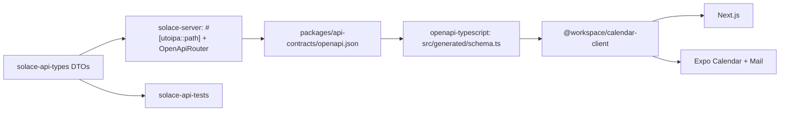

# Plan 001: Rewrite the Solace backend in Rust

> Executor: rewrite the backend in Rust, authentication included; deploy it to a Railway test environment and test it there; switch production in one change; then delete the TypeScript backend. There is no auth bridge, no side-by-side comparison deployment, and no partial production rollout. Read this plan fully before starting and do the steps in order. This plan is not permission to deploy to production.

## Goal and constraints

- **Goal:** the same API, behavior, and data on a Rust backend with much lower process RAM. Hosting cost is not a decision input.
- **Unchanged:** the Postgres schema and its 53 migrations (Prisma keeps applying them until step 7), the wire contract that shipped native apps rely on, the privacy and E2EE rules in AGENTS §2, JMAP-only mail (§8), the Go notifications worker, and Stalwart.
- **Known privacy gaps** (AGENTS §2) are ported unchanged, never wider, and fixed in step 7. A rewrite that also changes behavior can't be checked against the old backend, and a fix needing a client release would block the cutover.
- **During the rewrite** every backend change ships with a test-suite case (step 3), so the Rust port inherits it as a failing test.
- Planned at `9867af06c9d873e5522fdd298b9cf585121e7c24` on 2026-10-14. Drift check before starting: `git diff --stat 9867af06..HEAD -- apps/backend packages/calendar-core packages/calendar-client packages/calendar-ics apps/web packages/native-core apps/native-calendar apps/native-mail`.

## Behavior the rewrite must match exactly

**Sessions and auth** (`apps/backend/lib/auth.ts`)

- Cookie names `__Secure-better-auth.session_token` (production) and `better-auth.session_token` (development), the HMAC-signed value format, and `crossSubDomainCookies` on the RP ID domain stay permanently. Changing them signs out every native install.
- Sessions last 14 days, renew daily, and clients refresh hourly (`packages/calendar-core/src/auth-session.ts`). Every Set-Cookie header is forwarded, never just the first.
- Rust does not implement the 5-minute `session_data` cookie cache. It reads the session row on every request, which is also stricter on revocation, and expires any `session_data` cookie it receives. The native cookie jar must drop it (`packages/native-core/src/lib/session-cookie.ts:48`).
- Passwords are scrypt `N=16384, r=16, p=1, dkLen=64`, NFKC-normalized, stored as `hexSalt:hexKey`. The hex salt **string** is the scrypt salt. Each hash allocates 32 MiB.
- Also preserve:
  - stored passkeys and the step-up flow (`passkey-step-up.ts`, `passkey-bridge-session.ts`);
  - one-time tokens (3 minutes, stored hashed);
  - Expo origin and cookie handling;
  - invite-gated sign-up with `markInviteAccepted` mailbox approval;
  - legacy cookie cleanup (`auth-cookie-migration.ts`);
  - IP and user-agent stripping on session create;
  - Postgres-backed rate limits with HMACed keys;
  - password reset and updated mail over JMAP noreply.
- The `jwt()` plugin has no caller in web, native, the worker, or Stalwart. Confirm zero hits on `/api/auth/token` and `/api/auth/jwks` in production logs and don't port it. If there are hits, port it, including decrypting the existing JWKS keys.

**Data** (`apps/backend/prisma/`)

- 30 `@default(cuid())` IDs and 25 `@updatedAt` columns are set by the Prisma client, not by Postgres. Rust must set them on every insert and update. Better Auth tables use their own 32-character IDs.
- All 96 timestamp columns are `TIMESTAMP(3)` without time zone, holding UTC. The wire format is JS `toISOString()`: exactly three fractional digits and `Z`.
- Ownership and share checks, transactions, ordering, pagination, retention, account deletion, and outbox writes behave as today.

**Wire contract** (`apps/backend/contracts/`, `packages/calendar-core/src/route-schemas.ts`)

- JSON fields are camelCase. Requests reject unknown fields. PATCH fields distinguish omitted, `null`, and a value.
- Query strings coerce like Zod does. String limits count UTF-16 code units. Errors use the `lib/errors.ts` envelope.
- Event listing reproduces `EventService.list`: recurring and modified instances, categories, calendars, participant filtering, and sort order.
- `packages/calendar-ics/src/recurrence.ts` is hand-written and ports directly. Subscription feeds go through `node-ical`, which wraps rrule.js, and its quirks need golden tests built from real feeds.
- `lib/mail-key-utils.ts` uses openpgp only for `readKey`; replace it with the `pgp` crate.

## Stack

Axum and Tokio; SeaORM 2.0.x on its SQLx Postgres driver, one pool for everything; Serde; utoipa with `utoipa-axum`; `better-auth` (better-auth-rs, pinned exact) if step 2 passes; jiff for time zones and recurrence; RustCrypto `scrypt`/`hmac`/`sha2`; webauthn-rs-core; reqwest with rustls; `thiserror`; `tracing`; the `sentry` crate pointed at Errex; jemalloc or mimalloc. Every dependency goes in `[workspace.dependencies]` with a one-line reason in the PR.

better-auth-rs targets 1:1 behavior with TypeScript `better-auth@1.7.6` and tests itself against a TypeScript reference server. It is alpha, stores data through SeaORM only, and locks `sea-orm 2.0.0-rc.37` while stable is 2.0.4. It lacks Expo, one-time tokens, JWT, and Solace's custom hooks, which you build as plugins on top, along with a scrypt `PasswordHasher`. Never run its `create_auth_tables`; your existing tables are the schema. If it fails step 2, build the same design on webauthn-rs-core and RustCrypto, and borrow from its MIT/Apache code.

## Code structure

This follows established Rust backends: a flat `crates/` workspace with a virtual manifest and `xtask` (rust-analyzer, matklad), API types in their own crate and a template test database (crates.io), black-box API tests in one `tests/api` binary (Zero To Production), and generated SeaORM entities kept apart from hand-written model code (Loco).

```text
Cargo.toml                  # virtual workspace: members, [workspace.dependencies], [workspace.lints]
Cargo.lock
rust-toolchain.toml
.cargo/config.toml          # alias: cargo xtask
crates/
  solace-api-types/         # request/response DTOs + OpenAPI schemas; serde + utoipa only
  solace-server/
    Dockerfile
    src/
      main.rs               # config, telemetry, serve, graceful shutdown
      lib.rs                # router() and openapi(), shared by main, tests, and xtask
      config.rs             # typed env config, parsed once, fails fast on missing secrets
      state.rs              # AppState: pool, HTTP client, config
      error.rs              # AppError -> lib/errors.ts envelope
      telemetry.rs          # tracing, redaction, Errex
      http.rs, http/        # extractors (AuthUser, Json/Query/Path with envelope rejections), middleware
      auth.rs, auth/        # better-auth-rs setup + Solace plugins
      db.rs, db/            # pool, ID and updated_at behavior; db/entities/ is generated, never hand-edited
      events.rs, events/    # routes.rs, service.rs, queries.rs
      calendars.rs ...      # one module per current route/service pair
      mail.rs, mail/
      integrations/         # stalwart (jmap, admin, gate), safe_fetch, storage, ics
  solace-api-tests/
    tests/api/main.rs       # one test binary; one module per domain + helpers.rs
xtask/                      # openapi, entities, mem-budget, check
packages/api-contracts/     # generated TypeScript types for web and native
```

The API types crate depends only on serde and utoipa, so a database entity cannot end up in an API response: the compiler prevents it. A domain starts as one file such as `push_devices.rs`, and becomes a folder with `routes.rs`, `service.rs`, and `queries.rs` once it grows past about 300 lines. Modules use the `name.rs` plus `name/` style, as crates.io does, with no `mod.rs`.

Code rules:

- **Formatting:** default `rustfmt` (edition 2024, no `rustfmt.toml`), checked with `cargo fmt --check` in CI.
- **Lints** in `[workspace.lints]`, run in CI with `cargo clippy --all-targets -- -D warnings`:
  - Rust: `unsafe_code = "forbid"`, `rust_2018_idioms`, `unused`.
  - Clippy: `all`, `dbg_macro`, `todo`, `unwrap_used`, `expect_used`, `print_stdout`, `print_stderr`, with `allow-unwrap-in-tests` set in `clippy.toml`.
- **Handlers** only extract, call the service, and return the DTO: `AuthUser` from the session, a validated body or query, then `service::list(&state, user, query).await`. No SeaORM in handlers, and the owner ID always comes from `AuthUser`, never from the client.
- **Errors:** domain errors are `thiserror` enums converted into `AppError`. There's no `unwrap`/`expect` outside tests, and `anyhow` only in `main.rs` and `xtask`.
- **IDs** are newtypes (`EventId`) with `#[serde(transparent)]` and `#[schema(value_type = String)]`, so TypeScript still sees a string.
- **No traits with a single implementation and no mocks.** Services are plain functions over `&AppState`, and tests use real Postgres.
- **Logging:** `#[tracing::instrument(skip_all)]` on handlers and services, with only opaque IDs as fields. SeaORM's `debug-print` feature is never enabled, and SQL statement logging is off in production.
- **Comments** follow the AGENTS one-line rule, including `///` docs.

SeaORM entities are generated schema-first. `cargo xtask entities` builds a throwaway database from the 53 migrations and regenerates `db/entities/` with `sea-orm-cli`, and CI fails if the output differs from what's committed. `ActiveModelBehavior::before_save` sets the cuid IDs and `updated_at` in one place. Bulk `insert_many`/`update_many` skip that hook, so set those fields explicitly there.

## Type-safe frontend



- DTOs use `#[serde(rename_all = "camelCase")]`. Requests also use `deny_unknown_fields`, which must never be combined with `#[serde(flatten)]`. Tri-state PATCH fields are `Option<Option<T>>` via `serde_with::rust::double_option`, emitted as optional and nullable. Timestamps serialize as `%Y-%m-%dT%H:%M:%S%.3fZ`.
- Routes are registered with `OpenApiRouter` and `routes!`, as crates.io does, so a route and its OpenAPI entry can't drift apart. `cargo xtask openapi` writes `openapi.json` without a database connection and runs `bun run --cwd packages/api-contracts generate`. CI fails on any diff.
- `calendar-client` keeps its `HttpClient` and methods but types them with the generated `paths`/`components`. Web, native-core, and both apps switch in the same change. Client models with `Date` objects, on-device encryption, and Zod form validation stay in calendar-core.
- The test suite deserializes responses with the same DTOs, so the backend, the tests, and the frontend all share one definition.

## Memory

Budgets are fixed values, not comparisons with Bun. `cargo xtask mem-budget` enforces them in CI, reusing the RSS/PSS/VmHWM sampling in `experiments/backend-rust/benchmark.py`. Lock the final values after the skeleton (step 4a).

| Budget | Starting value |
| --- | --- |
| Idle RSS | ≤ 30 MiB |
| Steady mixed workload | ≤ 80 MiB |
| 20 concurrent sign-ins | ≤ idle + 2 × 32 MiB + 16 MiB |
| 60 s after that burst | within 10% of before |
| Growth over a one-hour soak | ≤ 5% |

How to stay inside them:

- **Threads and allocator:**
  - Run scrypt on the blocking pool behind a semaphore of 2.
  - Use jemalloc or mimalloc, picked by measurement; never musl's default allocator.
  - Set Tokio `worker_threads` to 2 and cap `max_blocking_threads`.
- **Large bodies:**
  - Stream JMAP blob uploads and downloads; buffer for the 401 retry only below a size cap.
  - Decode rows directly into DTOs, with no `serde_json::Value` on hot paths.
  - Lists select only the columns they return, never `find_with_related` on large sets, and `.stream()` for sync and exports.
- **Background work:**
  - Run subscription sync one job at a time.
  - Keep one Stalwart EventSource per account and fan it out over a small bounded `broadcast` channel.
  - Bound every in-memory map and cache.
- **Pool and build:** keep the database pool small, and build for `x86-64-v3` (not `target-cpu=native`).

## Steps

### 1. Test environment

Railway currently has only `production`, and Vercel previews and `apps/backend/.env` point at the production database.

- Create a Railway test environment containing:
  - its own Postgres 18, built from the 53 migrations, with synthetic data: users, invites, sessions, scrypt passwords, passkeys, encrypted records, reminders, and mail accounts;
  - a test Stalwart mailbox, bucket, and push sink;
  - test secrets.
- The suite and `xtask` refuse any production database, mailbox, bucket, secret, or URL.
- When running the current backend locally against this environment, set every `STALWART_*` variable, because it otherwise falls back to production Stalwart.

**Result (2026-10-14, done):**

- Railway environment `test` (created empty): `test-postgres` (postgres-ssl:18, volume, TCP proxy), `test-stalwart` (`apps/stalwart/test-env`: no frp, remote delivery black-holed, backend gate on its Railway domain), `test-notifications` (the Go worker without APNs credentials, so push jobs end `skipped` in `notification_job`: that is the push sink) and bucket `solace-test-avatars`. The app database is `solace_test_seed`.
- `cargo xtask test-env up|template|clone|seed|stalwart-key` runs the same setup locally in podman. `seed` creates the synthetic data through the TypeScript backend (`cargo xtask ts-backend --checkout <worktree without .env files>`), so passwords, sessions and passkeys are exactly what it writes. `cargo xtask deploy-test` uploads only a `git archive` to `test-*` services in `test`.
- The guard: test secrets and database passwords are `solace-test-*`, databases `solace_test*`, buckets `solace-test-*`, the mail domain `.test`, and hosts loopback, `*.railway.internal` or `*-test.up.railway.app`.
- Finding: the committed `solace-provisioner` role can't provision a mailbox on Stalwart 0.16.21. It also needs the User role (to grant it) and `impersonate` (keys, account settings), so the test provisioner has both. Production presumably still runs on the `STALWART_ADMIN_TOKEN` fallback. Production is unchanged.

### 2. Auth spike (go/no-go)

Point better-auth-rs at a copy of the test database and prove four things:

1. A session cookie issued by the current backend validates.
2. An existing scrypt password signs in through the custom hasher.
3. An existing passkey authenticates.
4. The Expo app signs in.

Also prove that it builds against SeaORM 2.0.4 and maps onto the existing tables and snake_case columns. If it fails, run the same four checks on the primitives design. If that fails too, stop. Check the JWT plugin logs in this step as well.

**Result (2026-10-14): go, on the primitives design.**

- **better-auth-rs `1.0.0-alpha.3` fails.** It builds against SeaORM 2.0.4 (the published crate is not pinned to rc.37; its compatibility target is TypeScript `better-auth@1.6.29`), but it can't use the existing schema:
  - every core timestamp is `DateTimeUtc`, and decoding our `TIMESTAMP(3)` columns fails (`TIMESTAMPTZ is not compatible with SQL type TIMESTAMP`), so sign-in returns 500;
  - the session entity needs an `active` column that every session query filters on;
  - the passkey entity is fixed to a `passkeys` table with snake_case columns and a required `credential` column holding a serialized webauthn-rs passkey. Our rows have only the COSE key, so existing passkeys can't authenticate;
  - the session cookie is read and written as the raw token, not Better Auth's `token.HMAC`, so sessions don't work in either direction.
- **The primitives design passes all four checks** (axum, SeaORM 2.0.4 over the existing tables including the camelCase `passkey` columns, RustCrypto HMAC/scrypt, webauthn-rs-core 0.5). It ran against a copy of a database seeded through the TypeScript backend:
  1. every TypeScript-issued session cookie validates (seven sessions, three users);
  2. the TypeScript scrypt passwords sign in, and wrong passwords get 401;
  3. TypeScript-registered passkeys authenticate: a single-device key with a counter, and a synced key (backup-eligible, backed up, counter always 0). The `Credential` is rebuilt from the stored COSE key, counter and device type;
  4. the real `@better-auth/expo/client` signs in and reads the session for the `solace` and `solace-mail` schemes. Only the React Native and Expo native modules are stubbed. An untrusted scheme gets the same 403 `INVALID_ORIGIN` as on TypeScript.

  In the other direction, Rust-issued sessions validate on the TypeScript backend, and the same passkeys keep working there after Rust bumped their counters. webauthn-rs-core needs OpenSSL, so the Dockerfile needs `libssl-dev`, and local builds without system headers need `OPENSSL_DIR`.
- **JWT log check: not conclusive yet.** Vercel keeps about an hour of runtime logs for `solace-api`. In that window there were 0 hits on `/api/auth/token` and `/api/auth/jwks`; the `requestPath:` filter was verified against `/api/health`. The repo has no caller either. A read-only sampler checks every 40 minutes while this work runs. The plugin stays unported unless a hit appears.

### 3. Test suite against the current backend

Build `solace-api-tests`. By default it starts the Rust server in-process on a random port, with a fresh database cloned from a template database. With `API_BASE_URL` set, it targets a running backend, and state checks read `TEST_DATABASE_URL`.

- Cover every route as owner, permitted sharee, revoked sharee, unrelated user, anonymous caller, and forged owner ID. Check the response and the database and outbox state.
- Port the 14 checks in `apps/backend/e2e/api-security.e2e.ts`.
- Give every Jest case a destination: a suite case, a Rust unit test, or "not applicable" with a reason. Build the starting list from Jest's `--json` output, which includes every parameterized row.
- Run the suite against the current backend until it passes.
- Add the "every backend change ships with a suite case" rule to both AGENTS files.

**Result (2026-10-14, done):**

- `crates/solace-api-tests`: one `tests/api` binary with 400 tests in 29 domain modules. Every route and method in `apps/backend/routes/` and every Better Auth endpoint Solace uses is hit, and responses deserialize through the `solace-api-types` DTOs. Until the Rust server exists the suite needs `API_BASE_URL` (the in-process default arrives with 4a).
- It passes 400/400 against the TypeScript backend in development mode and with `TEST_BACKEND_MODE=production` (Secure cookie names, HSTS, production CORS and origins, legacy cookie clears), on the local podman environment with repeated parallel runs.
- The 14 `api-security.e2e.ts` checks are ported one-to-one in `e2e_security.rs`. The web check runs only with `TEST_WEB_URL`.
- All 796 Jest cases have a destination (`jest/*.tsv`, checked by `cargo xtask jest-destinations --complete`): 572 suite cases, 188 Rust unit tests to write in step 4, and 36 not applicable with a reason.
- Both AGENTS files carry the suite rule.
- Corrected above: one-time tokens last 3 minutes (Better Auth's `expiresIn` is in minutes), not 3 seconds.
- The test Stalwart needed production's `maxConcurrentRequests: 32` (the default of 4 fails concurrent noreply sends) and no IP bans (every podman-forwarded request shares one address).
- Findings in the current backend, pinned as today's behavior so Rust matches them until they are fixed on purpose:
  - **Security:** `POST /api/auth/passkey-bridge/complete-step-up` marks any password-only session as passkey-verified, which bypasses the passkey second factor (`passkeys::complete_step_up_marks_any_session_verified_known_gap`).
  - **Security:** the JMAP proxy serves a session that still needs passkey step-up, while `/api/mail/oauth/access-token` refuses the same session with 403.
  - **Privacy:** the public ICS feed's `X-WR-CALDESC` names the owner and falls back to the owner's email.
  - Body validation runs before auth, so an anonymous malformed body gets 400 instead of 401.
  - The recurring list ignores deleted and modified occurrences, and an overdue reminder clamp hits a constraint and returns 500.
  - Account deletion leaves orphaned `recurrence_exception` rows, passkey challenges in `verification`, and participant emails on other users' events.
  - The TypeScript mailer doesn't retry Stalwart's per-account JMAP concurrency limit, so bursts of app mail beyond it fail as `email_delivery_failed`.
  - TypeScript honors a `session_data` cookie for up to 5 minutes after the session is revoked or expires. Rust won't (see "Sessions and auth"), and the suite branches on the backend there.

### 4. Build the Rust backend

Each sub-step is done when its suite cases pass against Rust and the memory budgets hold.

- **4a. Skeleton:**
  - workspace, lints, `xtask`, and the API types crate with OpenAPI-to-TypeScript generation, then calendar-client on generated types;
  - config, telemetry with redaction shared from `packages/calendar-core/src/redaction-policy.js`, the error envelope, security headers, CORS and origin checks, body and time limits, and graceful shutdown;
  - generated SeaORM entities;
  - session validation, daily renewal, and Set-Cookie forwarding, with sessions from the current backend accepted;
  - memory budgets locked;
  - both AGENTS files updated with the Rust conventions above and the privacy-gap exception.

  **4a result (2026-10-14, done):**

  - `crates/solace-server` covers:
    - typed config from the TypeScript backend's variable names, failing fast on a weak `BETTER_AUTH_SECRET` in production;
    - telemetry, whose redaction keys are read from `redaction-policy.js` at build time and whose Errex reports pass the `scrubErrorEvent` rules;
    - the `lib/errors.ts` envelope;
    - security headers, CORS and the runtime origin policy;
    - a validator that reproduces Zod 3.25's messages, issue paths and order (and renders Zod 4's for Better Auth's endpoints);
    - Vercel's limits as today's contract (4.5 MB bodies, 300 s per request);
    - graceful shutdown;
    - Better Auth session validation with daily renewal, step-up cookie renewal and Set-Cookie forwarding;
    - the guard, the health routes and Better Auth's error page.
  - Elysia validated requests before the auth guard answered, so the guard is an extractor that handlers `require()` after validation.
  - `cargo xtask entities` generates `db/entities` from the 53 migrations. Ids and timestamps are defaulted in `db/behavior.rs`.
  - `cargo xtask openapi` emits every DTO as a component (routes join as they land) into `packages/api-contracts` (openapi-typescript 7.13.0). Response fields that are always written are required and nullable.
  - `calendar-client` is typed with the generated components, and web, native-core and both apps changed in the same merge. That switch found:
    - missing DTOs for settings updates and invite validate/claim;
    - optional fields the backend omits rather than nulls;
    - client types that mistyped revived dates or claimed routes that don't exist.
    - Still open: search hits carry trimmed calendar/category labels while `EventSearchResult` still claims full rows. Web also offers a "3 Days" default view that the backend's strict settings schema rejects, a current bug.
  - The suite starts the Rust server in-process on a fresh clone of the template database unless `API_BASE_URL` is set.
  - 4a's suite cases are those that need no account: they pass on Rust in both modes (`crates/solace-api-tests/rust-passing.txt`, 10 cases). Session cases move to 4b, because the suite creates accounts through sign-up.
  - `cargo xtask check` runs everything CI needs and fails if a listed case regresses.
  - **Memory budgets locked** at the values in the Memory table above, unchanged:
    - On the skeleton, jemalloc measured 15.1 MiB idle and 18.1 MiB at steady peak, against mimalloc's 22.9 and 26.1 (glibc: 13.2 and 15.6), so jemalloc is the default allocator.
    - The sign-in burst budget is measured once sign-in exists (4b).
  - Both AGENTS files document the Rust conventions and the known-gap exception.
  - For step 5: the TypeScript backend trusts `x-real-ip`/`x-forwarded-for` because Vercel's edge overwrites them, and Rust reads the same headers. Before Railway serves real traffic, verify which of them Railway's proxy controls.
- **4b. Auth flows:**
  - sign-up with the invite gate, sign-in, sign-out, and session list and revoke;
  - password change and reset;
  - passkeys, with register, sign-in, list, update, delete, and step-up;
  - the fresh-session bridge, one-time tokens, Expo, rate limits, and legacy cookie cleanup.
  - Sessions, passwords, and passkeys created by either backend must work on the other.
- **4c. Calendar and account:**
  - settings, profile and avatars, calendars, categories, and recent contacts;
  - events (CRUD, bulk, recurring edits, search), participants and RSVP, and invitations;
  - subscriptions through the `safe_fetch` equivalent (address checked at connect-time DNS, every redirect revalidated, size and time caps);
  - E2EE metadata, push devices, and account deletion.
  - Ciphertext is stored byte for byte, and mixed plaintext-plus-ciphertext requests are rejected.
- **4d. Mail:**
  - accounts, bootstrap with `wrappedSecret` required, keys, sync, and settings;
  - the JMAP proxy, which relays Bearer tokens only and streams;
  - owner-authenticated JMAP, realtime/SSE, and signed Stalwart webhooks with dedupe;
  - the backend gate on every Stalwart fetch.
  - No SMTP or IMAP, and the provisioning token never reads mail.

### 5. Deploy to the Railway test environment and test

- **Build:** `crates/solace-server/Dockerfile` with the build context at the repo root. It's a multi-stage build with a pinned Rust image, `cargo build --release --locked -p solace-server` for `x86-64-v3`, and a slim runtime with CA certificates running as a non-root user.
- **Run:** bind `0.0.0.0:$PORT` with `/api/health` as the health check. Use one replica on the private network to the test database. Drain on SIGTERM.
- **Background work:** the server runs calendar sync and the realtime connections on that single replica. The Go worker still owns the outbox and retention.
- **Then test:**
  - the full suite with `API_BASE_URL` set to the Railway service;
  - the web app and both native apps through sign-in, calendar, and mail flows, including a passkey on a real device;
  - the memory budgets measured on Railway;
  - a one-hour soak;
  - a rollback drill: Rust writes data and renews sessions, then the test environment switches to the TypeScript backend, and data and sessions must still work.

### 6. Cutover

This happens only with explicit go-ahead.

1. Take a backup and test restoring it.
2. Move `api.solace.onl` from Vercel to the Railway Rust service. The hostname stays the same, so cookies, passkeys, and native apps need no release.
3. Keep the Vercel API deployment untouched. Rolling back means moving the domain back.
4. Freeze schema changes and watch auth, errors, outbox, mail, and memory for 14 days, one full session lifetime.
5. Roll back on any security problem, session failure, wrong data, duplicate side effect, or exceeded threshold.

### 7. Delete TypeScript and clean up

- Remove `apps/backend`, Prisma, the Better Auth server packages, and, after confirming, the Vercel API project. Keep the frontend, shared-package, and Go tests.
- Move migrations to `sea-orm-migration`, baselined at migration 53, keeping the `_prisma_migrations` history.
- Fix the known privacy gaps, delete them from AGENTS §2, and remove the exception.
- Optional: rehash passwords to argon2id on sign-in.
- Update CI (Rust jobs replace backend Jest), root scripts, repo rules, the README, and both AGENTS files.

## Done checklist

- [ ] `cargo xtask check` passes in CI: fmt, clippy, tests, OpenAPI and entity diffs, memory budgets.
- [ ] The suite passes against the current backend (step 3), local Rust, and Rust on the Railway test environment.
- [ ] Every Jest case has a destination, and the 14 security checks pass.
- [ ] Existing sessions, passwords, and passkeys work on Rust, and Rust-issued ones work on TypeScript.
- [ ] Web, Expo Calendar, and Expo Mail pass sign-in, calendar, and mail flows against the Railway test environment, including a real-device passkey.
- [ ] Memory budgets are met on Railway, and p95 latency of the main flows is no worse than current production.
- [ ] Privacy holds:
  - ciphertext is stored unchanged;
  - a sentinel test finds no user content or PII in logs;
  - SSRF, webhook HMAC, CORS, and cookie-attribute tests pass;
  - the known gaps are unchanged.
- [ ] The backup restore and the rollback drill both pass.

## Stop if

- Neither better-auth-rs nor the primitives design keeps existing sessions, passwords, and passkeys working. Resetting users' logins is not allowed.
- The rewrite would need a schema change, a different wire format for shipped apps, or plaintext where there's ciphertext today.
- Any test touches a production database, mailbox, bucket, or URL.

## References

- [crates.io](https://github.com/rust-lang/crates.io): Axum with `utoipa-axum` routers, a separate API-types crate, a template test database, workspace lints.
- [Zero To Production](https://github.com/LukeMathWalker/zero-to-production): black-box `tests/api` binary, typed configuration, telemetry module.
- [Loco](https://github.com/loco-rs/loco): SeaORM `_entities` generated apart from hand-written model code.
- [Large Rust workspaces](https://matklad.github.io/2021/08/22/large-rust-workspaces.html) and [cargo-xtask](https://github.com/matklad/cargo-xtask): flat `crates/`, virtual manifest, xtask.
- [better-auth-rs](https://github.com/better-auth-rs/better-auth-rs) and its [roadmap](https://github.com/better-auth-rs/better-auth-rs/blob/master/ROADMAP.md); [SeaORM](https://www.sea-ql.org/SeaORM/docs/index/); [utoipa-axum](https://docs.rs/utoipa-axum/latest/utoipa_axum/); [openapi-typescript](https://openapi-ts.dev/introduction); [jiff](https://docs.rs/jiff/latest/jiff/); [Railway Dockerfiles](https://docs.railway.com/builds/dockerfiles) and [monorepos](https://docs.railway.com/deployments/monorepo).
